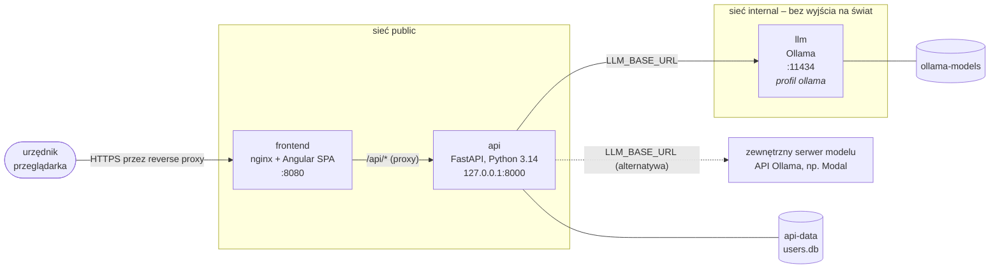

# 1. System i wdrożenie

## Co system robi

Urzędnik wgrywa blankiet wniosku (PDF, DOC, DOCX, ODS, XLSX, JPG, PNG). System zwraca
JSON w formacie importu Generatora Formularzy COI oraz raport: co rozpoznano, skąd się
wzięło każde pole i co warto sprawdzić ręcznie. Wynik można obejrzeć jako działający
formularz, poprawić w edytorze i pobrać.

System nie przechowuje dokumentów ani wyników. Jedyny trwały zapis to baza kont
zarejestrowanych użytkowników (SQLite).

## Kontenery



| Kontener | Obraz | Odpowiada za | Stan |
|---|---|---|---|
| `frontend` | `nginx:1.28-alpine` + build Angulara | serwuje SPA, proxy `/api/`, nagłówki bezpieczeństwa (CSP), limit prób logowania i rejestracji (10/min na IP) | brak |
| `api` | `python:3.14-alpine` + LibreOffice, Tesseract (`pol`, `osd`), libmagic | cały pipeline konwersji, uwierzytelnianie, katalogi słowników | `/data/users.db` na wolumenie `api-data`; poza tym `tmpfs` |
| `llm` | własny obraz na bazie `ollama/ollama`, bez bibliotek CUDA (target `cpu`) | inferencja modelu | modele w wolumenie `ollama-models` |
| `llm-pull` | jak `llm` | jednorazowe pobranie modelu (profil `setup`, sieć `egress`) | — |

Definicje: `docker-compose.yml`, `docker-compose.gpu.yml`, `backend/Dockerfile`,
`frontend/Dockerfile`, `frontend/nginx.conf`, `llm/Dockerfile`.

### Sieci

- **`internal`** (`internal: true`) – `api` ↔ `llm`. Kontener modelu nie ma portu na hoście
  ani wyjścia do internetu. `OLLAMA_NO_CLOUD=1` wyłącza funkcje chmurowe Ollamy.
- **`public`** – porty na hoście. API jest publikowane tylko na `127.0.0.1`; z zewnątrz
  dostępne wyłącznie przez nginx, który dokłada CSP i rate limit logowania.
- **`egress`** – tylko `llm-pull`, tylko na czas pobrania modelu.

`api` jest też w `public`, bo w trybie z zewnętrznym serwerem modelu potrzebuje wyjścia
do internetu (albo do `host.docker.internal`).

### Utwardzenie kontenerów

Wspólny blok `x-hardening` w compose: system plików tylko do odczytu, `cap_drop: ALL`,
`no-new-privileges`. Procesy działają jako nie-root (`app` uid 10001, `nginx`, `ollama`
uid 10002). `api` ma `init: true` (tini jako PID 1 zbiera osierocone procesy LibreOffice
po timeoucie), `pids_limit` i `mem_limit`. Obrazy bazowe są przypięte digestem.

## Skąd pochodzi model

Wybór robią dwie zmienne w `.env`: `COMPOSE_PROFILES` i `LLM_BASE_URL`. Backend zawsze
mówi protokołem Ollamy (`/api/chat`, `/api/tags`), więc nie wie, który wariant działa.

| Wariant | `COMPOSE_PROFILES` | `LLM_BASE_URL` | Uwagi |
|---|---|---|---|
| lokalny CPU | `ollama` | `http://llm:11434` | domyślny w `.env.example`; `qwen3:8b`, ok. 16 GB RAM, 1,5–5 min na dokument |
| lokalny GPU | `ollama` | `http://llm:11434` | dodatkowo `-f docker-compose.gpu.yml` (target `gpu`, obraz producenta z CUDA) |
| zewnętrzny | puste | URL serwera | `.env` w repozytorium: Modal, `qwen3.5:35b-a3b`; nagłówki proxy auth z `LLM_AUTH_KEY` / `LLM_AUTH_SECRET` |

Endpoint na Modalu definiuje `scripts/modal_ollama.py` (jeden kontener GPU, gaśnie po
bezczynności, więc pierwsze żądanie po przerwie czeka na zimny start).

## Granice zaufania

```
przeglądarka ──(niezaufane: plik, hasło, JSON do walidacji)──▶ nginx ──▶ api
api ──(niezaufane: treść dokumentu jako prompt)──▶ model
model ──(niezaufane: odpowiedź JSON)──▶ api
```

Każda strzałka do `api` jest traktowana jak wejście od atakującego:

- **Plik** przechodzi walidację przed jakimkolwiek parsowaniem treści: nazwa i rozszerzenie
  z nagłówka części multipart, rozmiar liczony w trakcie odbioru, MIME z zawartości
  (libmagic), bomby ZIP z katalogu centralnego, XML bez DTD (`defusedxml`), limit stron PDF
  i pikseli obrazu. Szczegóły: [02-pipeline.md](02-pipeline.md#1-walidacja-wejścia).
- **Wynik LibreOffice** to nadal dane niezaufane – przechodzi tę samą kontrolę ZIP co upload.
- **Treść dokumentu w prompcie** jest zamknięta w `<dokument>…</dokument>`; zamykający tag
  w treści jest neutralizowany. Model nie może niczego „zlecić” – zwraca dane w sztywnym
  schemacie, a kod ich nie wykonuje ([ADR 0001](adr/0001-ai-rozumie-kod-buduje.md)).
- **Odpowiedź modelu** jest walidowana schematem Pydantic i naprawiana w kodzie.
- **JSON z `/forms/validate`** jest kopiowany i sprawdzany defensywnie – weryfikator nigdy
  nie rzuca wyjątku na złym kształcie danych.

## Dane osobowe

- Dokument i wynik żyją tylko w pamięci żądania (`SpooledTemporaryFile`, katalogi
  tymczasowe na `tmpfs` usuwane także przy błędzie i anulowaniu).
- Logi to JSON z metadanymi: rozmiar, format, czasy etapów, kody ostrzeżeń. Nazwa pliku
  trafia do logu jako 12 znaków SHA-256. Błędy bibliotek parsujących są logowane tylko
  typem wyjątku, bo ich komunikaty potrafią cytować treść.
- W przeglądarce: JWT w `sessionStorage`; pliki, hasła i wyniki tylko w pamięci karty.
  Szczegóły: [04-frontend.md](04-frontend.md#dane-w-przeglądarce).

## Uwierzytelnianie

API wymaga `Authorization: Bearer <JWT>` na wszystkim poza `/health/*` i `/auth/*`.
Lista routerów chronionych jest jawna w `backend/app/main.py`: nowy router trafia tam,
chyba że świadomie ma być publiczny.

Dwa tryby, wybierane konfiguracją:

1. **API wydaje tokeny** (HS256 albo RS256 z kluczem prywatnym) – konto techniczne
   z `.env` (`API_USER` + hash argon2id) i opcjonalnie konta z rejestracji (SQLite).
2. **API tylko weryfikuje** (RS256, sam klucz publiczny) – tokeny wydaje broker tożsamości,
   router `/auth` nie jest rejestrowany. To ścieżka do logowania przez Węzeł Krajowy:
   [wezel-krajowy.md](wezel-krajowy.md).

Weryfikacja nie wykonuje wywołań sieciowych (klucz statyczny, bez JWKS). Algorytm
pochodzi z konfiguracji, nigdy z nagłówka tokenu.
