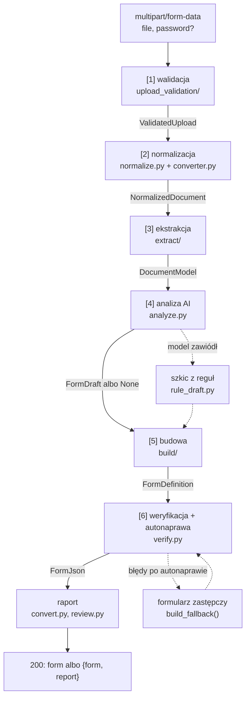

# 2. Pipeline konwersji

Jedno żądanie `POST /api/v1/forms/convert` przechodzi sześć etapów. Każdy ma jeden plik
wejściowy w kodzie i jeden typ danych na wyjściu.



Orkiestracja:

- `backend/app/api/v1/forms.py` – HTTP: odbiór strumienia, wybór modelu (`?model=`),
  semafory, kształt odpowiedzi. Etap [1].
- `backend/app/pipeline/convert.py` – `convert_upload()`: etapy [2]–[6] i raport.
  Nie zna HTTP; ten sam kod woła skrypt wsadowy `scripts/convert_all.py`.

## Kontrakty między etapami

| Typ | Plik | Co niesie | Kto tworzy → kto czyta |
|---|---|---|---|
| `ValidatedUpload` | `upload_validation/validate.py` | strumień (po ewentualnym odszyfrowaniu), `kind`, MIME, rozmiar, liczba stron | [1] → [2] |
| `NormalizedDocument` | `normalize.py` | strumień w formacie PDF/DOCX/XLSX/JPEG/PNG – nigdy DOC/ODS | [2] → [3] |
| `DocumentModel` | `models/document.py` | strony → bloki (`heading`, `paragraph`, `label`, `input_placeholder`, `checkbox_option`, `table`, `table_cell`) z `bbox` i pewnością OCR | [3] → [4], raport |
| `LlmDraft` | `models/draft.py` | surowa odpowiedź modelu; luźna, z domyślnymi wartościami | model → [4] |
| `FormDraft` | `models/draft.py` | ścisły, spójny szkic: tytuł, organ, rodzaje wnioskodawcy, strony przedmiotu → sekcje → pola, warunki `visible_when` | [4] → [5] |
| IR (`PageNode`, `SectionNode`, `FieldNode`) | `build/ir.py` | formularz przed serializacją, z kluczami węzłów `p1.s2.f3` | wewnątrz [5] |
| `FormDefinition` / `FormJson` | `models/form.py` | format importu COI: `title`, `tabs[].questions[].field`, `flow` | [5] → [6] → klient |

`DocumentModel` jest niezależny od formatu wejścia: po etapie [3] reszta pipeline'u nie
wie, czy źródłem był skan, czy arkusz.

## [1] Walidacja wejścia

`upload_validation/`, kolejność w `validate.py`:

1. **Odbiór strumieniowy** (`receive.py`). Endpoint nie deklaruje `UploadFile`, bo FastAPI
   wczytałby całe ciało przed walidacją ([ADR 0003](adr/0003-strumieniowy-odbior-uploadu.md)).
   Parser multipart odrzuca drugi plik, liczy rozmiar w locie, treść trafia do
   `SpooledTemporaryFile` (RAM do `SPOOL_MAX_MB`, potem anonimowy plik).
2. **Nazwa i rozszerzenie** (`filename.py`) – z nagłówka części, zanim przeczytamy treść.
   Nazwa nigdy nie trafia do ścieżki w systemie plików.
3. **MIME z zawartości** (`mime.py`, libmagic). `Content-Type` od klienta jest ignorowany.
4. **Hasło** (`encryption.py`, `odf_encryption.py`). Plik zaszyfrowany bez pola `password`
   → 422 `DOCUMENT_PASSWORD_REQUIRED`; frontend pyta o hasło i ponawia żądanie. Dalsze
   sprawdzenia działają na odszyfrowanej kopii. ODS (AES-CBC+PBKDF2 i AES-GCM+Argon2id) jest
   zaimplementowany ręcznie, bo nie ma biblioteki bez copyleftu; parametry KDF z pliku są
   ograniczane.
5. **Struktura** (`containers.py`, `documents.py`): ZIP bez rozpakowywania (limit wpisów
   i rozmiaru po dekompresji, typ głównej części – makra i szablony odpadają, XML bez DTD),
   DOC przez `olefile`, PDF przez PDFium (liczba stron, otwarcie pierwszej), obrazy
   (wymiary z nagłówka przed dekodowaniem, `verify()`).

DOCX zapisany jako `.doc` jest przetwarzany jak DOCX – po pełnej kontroli struktury DOCX.

Kroki 2–5 blokują CPU, więc działają w puli wątków pod semaforem `validation_semaphore`
(2 × `MAX_CONCURRENT_JOBS`). Sam odbiór strumienia nie zajmuje miejsca w limicie.

## [2] Normalizacja

`normalize.py`, `converter.py`. DOC → DOCX i ODS → XLSX przez `soffice --headless`
w osobnym procesie, bez powłoki, z własnym profilem użytkownika w katalogu tymczasowym na
wywołanie. Przy timeoucie zabijana jest cała grupa procesów (`soffice` → `oosplash` →
`soffice.bin`). Pozostałe formaty przechodzą bez kopiowania.

Bez LibreOffice w obrazie (`converter=None`) DOC i ODS dostają 415, a `/health/ready`
zgłasza `degraded: ["converter"]`.

## [3] Ekstrakcja

`extract/`. Jedno wejście `extract()`, cztery ekstraktory i wspólny silnik układu.

| Format | Moduł | Źródło geometrii |
|---|---|---|
| PDF | `pdf.py` | pdfplumber: słowa ze współrzędnymi, linie, tabele, AcroForm. Strona z mniej niż 20 znakami tekstu idzie do OCR (decyzja per strona – blankiety bywają sklejone ze stron tekstowych i skanów) |
| skan / zdjęcie | `image.py`, `raster.py` | Tesseract (`pol`, korekta orientacji przez OSD, strony równolegle: `OCR_WORKERS`); ramki i podkreślenia szukane wprost w pikselach |
| DOCX | `docx.py` | akapity, tabele, pola tekstowe, glify Wingdings jako kratki |
| XLSX | `xlsx.py` | pozycje komórek z szerokości kolumn i wysokości wierszy, obramowania jako ramki pól |

`layout.py` zamienia fragmenty tekstu (`Span`), puste ramki (`Frame`) i tabele
(`TableGrid`) na linie i bloki w kolejności czytania. `grid.py` odtwarza ramki z odcinków
linii tak jak pdfplumber robi to dla tabel. `text_rules.py` rozpoznaje kratki,
wykropkowania i nagłówki – wspólnie dla wszystkich formatów.

Dzięki temu „pole do wpisania” jest rozpoznawane tą samą regułą niezależnie od tego, czy
w źródle było wykropkowaniem, rysowaną ramką w PDF, czy obramowaną komórką w arkuszu.

Awaria OCR nie przerywa żądania: strona zostaje pusta, raport dostaje `W11_OCR_UNAVAILABLE`,
a niska pewność – `W12_LOW_OCR_CONFIDENCE`. PDFium nie jest bezpieczne wątkowo, więc każde
wywołanie pypdfium2 trzyma globalną blokadę (`pdfium_lock.py`).

## [4] Analiza AI

`analyze.py`. Wejście: `DocumentModel`. Wyjście: `FormDraft` albo `None`. **Funkcja nigdy
nie rzuca z powodu modelu** – każda awaria kończy się fallbackiem z ostrzeżeniem.

### Przygotowanie tekstu

1. `doc_hints.annotate_choices()` oznacza listy wyboru, których ekstrakcja nie wykryła
   („❑ pies ❑ suka”, „TAK NIE” na końcu linii, lista po „zaznaczyć właściwą kratkę”).
   Zmienia tylko rodzaj bloków, nie treść – błąd tutaj pogarsza najwyżej podpowiedź.
2. `DocumentModel.to_prompt_text()` daje zwięzły tekst z markerami `[NAGŁÓWEK]`, `[POLE]`,
   `[OPCJA]`, `[TABELA]`. Pomija klauzulę RODO, pouczenia, objaśnienia, adnotacje organu
   i numery stron – nie dają pól, a zajmują większość długich blankietów. Powtórzony
   fragment zastępuje `[POWTÓRZENIE]`.

### Wywołanie modelu

Prompt: systemowy (`resources/prompts/system.md`), jeden przykład jako poprzednia tura
rozmowy (dokument → JSON) i dokument w `<dokument>…</dokument>`. Stały prefiks pozwala
Ollamie przetworzyć go raz – `main.py` rozgrzewa model przy starcie.

Odpowiedź jest wymuszona schematem (`format` = JSON Schema `LlmDraft`, constrained
decoding). Schemat jest płaski i bez `null`, bo tak działa to niezawodnie na małych
modelach ([ADR 0005](adr/0005-plaski-schemat-llm-i-naprawa-w-kodzie.md)).

- Dokument mieści się w kontekście → jedno wywołanie, **jedna** ponowna próba tylko przy
  odpowiedzi niezgodnej ze schematem (np. ucięty JSON) i tylko gdy zostało ≥ 1,2 × czasu
  pierwszego wywołania.
- Dokument dłuższy → fragmenty (`draft_merge.py`) bez ponowień. Nieudany pierwszy
  fragment to fallback; nieudany kolejny – `W14_PARTIAL_ANALYSIS` i łączenie reszty.

Rozmiar fragmentu wynika z `LLM_NUM_CTX`, rezerwy na odpowiedź i współczynnika 2,2 znaku
na token (polski tekst tokenizuje się gęściej niż angielski), ograniczony z góry przez
`LLM_MAX_CHUNK_CHARS`.

### Po odpowiedzi

| Krok | Moduł | Co robi |
|---|---|---|
| naprawa | `draft_repair.py` | `LlmDraft` → spójny `FormDraft`: warunek na polu tekstowym, nieistniejące lub powtórzone id. Poprawia w kodzie zamiast ponawiać wywołanie (na CPU ponowienie to minuty) |
| normalizacja | `draft_normalize.py` | usuwa pola dublujące dane wnioskodawcy, pola wyliczane, pola przepisane z przykładu w prompcie, duplikaty; przenosi zgody; dokłada warianty wyboru i załączniki wymienione w dokumencie; sprawdza etykiety i organ względem tekstu dokumentu |
| oświadczenia | `draft_rules.py` | oświadczenia bierze **z dokumentu**, nie od modelu – model je parafrazował i zużywał na nie najwięcej tokenów |

Każda poprawka to ostrzeżenie w raporcie. Wynik normalizacji ponownie przechodzi walidację
`FormDraft`.

### Fallback

```
model OK                      → FormDraft od modelu
timeout / brak serwera / zły  → W01_LLM_FALLBACK + rule_draft() → W24_RULE_BASED_DRAFT
  rule_draft nie znalazł pól  → None → formularz bez przedmiotu wniosku
dokument bez tekstu           → W01_LLM_FALLBACK, None (rule_draft nie ma z czego budować)
```

`rule_draft.py` traktuje każde wykropkowanie jako pole, etykietę bierze z tekstu przed nim
albo z opisu w nawiasie pod nim, sekcję z ostatniego nagłówka. Nagłówek blankietu (przed
tytułem „WNIOSEK…”) pomija, bo dane wnioskodawcy, adresata i datę dają sekcje predefiniowane.

## [5] Budowa formularza

`build/`, funkcja `build_form()`. W pełni deterministyczna: ten sam szkic i te same opcje
dają ten sam JSON (poza UUID, które można podmienić przez `id_factory`).

Układ stron jest stały:

| Strona | Typ | Źródło |
|---|---|---|
| Dane | `MAIN` | szablony: „Twoje dane”, adres, wnioskodawca / pełnomocnik / podmiot, organ (`resources/templates/*.json`) |
| strony przedmiotu | `MAIN` | `FormDraft.subject_pages`; dzielone, gdy sekcji jest więcej niż `MAX_SECTIONS_PER_PAGE` |
| Kontakt i zgody | `MAIN` | szablon kontaktu, załączniki, oświadczenia, zgoda RODO |
| Strona końcowa | `FINISH` | szablon podglądu wniosku; przy `FINISH_PAGE_STYLE=info_section` (domyślnie) jako `INFO_SECTION` |

Kolejne przejścia w `build/__init__.py`:

1. normalizacja szkicu: deduplikacja załączników, `OTHER_PERSON` zawsze z `SELF`;
   pliki pełnomocnictwa ze szkicu są usuwane, bo zbiera je sekcja predefiniowana
   (warunkowo, z opłatą skarbową);
2. tytuł (`fields.normalize_title`) – prefiks „Wniosek…”, długość, odwołania do przepisów;
3. strony i sekcje z szablonów + strony przedmiotu (`sections.py`, `pages.py`,
   `layout.py` – siatka `x/y/rows/cols`);
4. mapowanie typów pól i walidatorów (`fields.py`): `short_text` → `TEXT_FIELD`,
   `single_choice` → `RADIO` albo `SELECT` (zależnie od liczby opcji), `multi_choice` →
   `CHECKBOX`; pole wyboru bez opcji degraduje się do tekstu z `W07_CHOICE_OPTIONS`.
   Znaczenie pola z etykiety (PESEL, NIP, kod pocztowy…) wyznacza walidator i słownik;
5. unikalne `techName`, słowniki (`dictionaries.py`), dane inicjalne
   (`initial_data.py`: `PESEL`/`MLPZ` jako `EXTERNAL_SYSTEM`, `readOnly`);
6. warunki widoczności → stany JSONata `SHOW`/`READ_ONLY` (`states.py`). Każde zapytanie
   jest kompilowane i sprawdzane semantycznie; escapowanie literałów jest dopasowane do
   ograniczeń `jsonata-python` (opis w docstringu modułu);
7. serializacja do `FormDefinition` (`serialize.py`) i walidacja modelem Pydantic;
8. propozycje słowników (`proposals.py`) – lista zamknięta i ogólnokrajowa bez słownika
   w katalogu zostaje inline, a propozycja trafia do raportu.

`build_fallback()` składa ten sam układ z jednym polem „Treść wniosku”. Używany, gdy nie
ma szkicu albo gdy zbudowany formularz nie przeszedł weryfikacji.

## [6] Weryfikacja i autonaprawa

`verify.py`, `verify_form(form, autofix=…)`. Działa na zwykłym słowniku, więc ten sam kod
sprawdza wynik konwersji i dowolny JSON wklejony w `/forms/validate`.

- **Autonaprawa** (`FIXES`, tylko przy konwersji): format dokumentu importu (literówki
  w kluczach starszych wzorców), brakujące klucze bazowe, pola poza sekcją, puste strony,
  duplikaty `id`/`techName`, tytuły sekcji, niedozwolone walidatory i stany, `flow`
  przebudowany liniowo. Każda naprawa trafia do `report.fixes`.
- **Reguły** (`RULES`): JSON Schema importu (`resources/schema/importowanyPlikJsonSchemat.json`)
  i reguły R01–R16 (tytuł, ≥ 2 strony, brak zagnieżdżonych sekcji, strona końcowa tylko
  informacyjna, `flow`, słowniki vs `options`, dane inicjalne, stany, unikalność, zgody,
  walidatory). Kody: `pipeline/issues.py`.

`verify_form` nigdy nie rzuca: wyjątek w regule lub naprawie staje się problemem `SCHEMA`.

Konsekwencja dla konwersji (`convert._build_and_verify`):

```
build_form → verify(autofix) → OK                → wynik
                             → błędy             → build_fallback → verify → OK → wynik + W27_FORM_REBUILT
                                                                           → błędy → 500
```

Odpowiedź 200 zawsze zawiera formularz, który przechodzi weryfikację
([ADR 0002](adr/0002-zawsze-poprawny-formularz.md)).

## Raport

Przy `?report=true` odpowiedź to `{form, report}`. Klucze składa `convert._report()`
i `review.build_review()`; schemat dla OpenAPI jest w `api/v1/schemas.py`.

| Klucz | Treść |
|---|---|
| `sourceFile` | nazwa, MIME, rozmiar, strony, czy odszyfrowano |
| `extraction` | metoda (`pdf_text` / `ocr` / `docx` / `xlsx`), liczba bloków, średnia pewność OCR |
| `llm` | model, czas, ponowienia, `fallback` + przyczyna, tokeny wejścia/wyjścia |
| `stats` | strony, sekcje, pola, stany |
| `warnings`, `fixes` | ostrzeżenia ze wszystkich etapów i naprawy weryfikatora |
| `dictionaryProposals` | propozycje nowych słowników |
| `timings`, `durationMs` | czas etapów |
| mapa pochodzenia + lista „do sprawdzenia” | dla każdego pola: szablon albo blok dokumentu (strona, tekst, `bbox`); ocena pewności z jawnych sygnałów |

Ocena pewności w `review.py` to heurystyka kolejności przeglądu, nie prawdopodobieństwo
poprawności: dopasowanie etykiety do tekstu, pewność OCR, szkic z reguł (× 0,85),
ostrzeżenia o całym formularzu.

Nagłówek `X-Conversion-Warnings` niesie liczbę ostrzeżeń także bez `report=true`.

## Czas i współbieżność

- **Jeden budżet na żądanie.** `deadline = now + REQUEST_TIMEOUT_S` liczony od wejścia
  żądania obejmuje odbiór, kolejkę, wszystkie etapy. Ekstrakcja po terminie →
  504 `PROCESSING_TIMEOUT`. Analiza nie zaczyna wywołania, gdy zostało < 30 s, i przechodzi
  na szkic z reguł. nginx ma `proxy_read_timeout 600s` > 540 s, więc 504 wysyła API,
  w formacie problem+json.
- **Dwa semafory** (`main.py`): `job_semaphore` (`MAX_CONCURRENT_JOBS`, domyślnie 2) na całą
  konwersję – Ollama na CPU i tak liczy po kolei; `validation_semaphore` (2×) na walidację
  uploadu i `/forms/validate`, żeby nie czekały za modelem. Kto nie dostanie miejsca przed
  terminem, dostaje 503 `SERVER_BUSY` z `Retry-After: 30`.
- **Wątki.** Etapy CPU (walidacja, ekstrakcja, budowa, weryfikacja, raport) działają
  w `anyio.to_thread`; pętla zdarzeń obsługuje tylko I/O.
- **Sprzątanie przy anulowaniu.** `normalize._in_thread` czeka na zakończenie wątku przed
  przepuszczeniem anulowania – inaczej `TemporaryDirectory` usunąłby katalog, w którym
  wątek jeszcze pisze.
