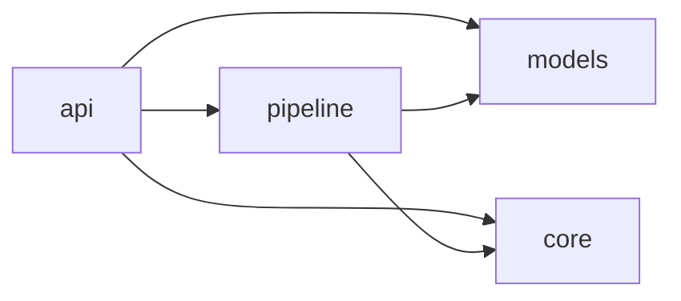

# 3. Backend

FastAPI, Python 3.14, zależności przez `uv` (`backend/pyproject.toml`, `uv.lock`).
Wejście: `app.main:create_app` (fabryka, `uvicorn --factory`).

## Warstwy

```
app/
├── api/v1/      HTTP: routery, parametry, kształt odpowiedzi, schematy OpenAPI
├── pipeline/    logika konwersji, bez wiedzy o HTTP
├── models/      typy danych (Pydantic), bez logiki i bez importów z app.*
├── core/        konfiguracja, błędy, logi, uwierzytelnianie, konta
└── resources/   dane: prompty, szablony sekcji, słowniki, TERYT, schemat importu
```

Kierunek zależności (sprawdzony na importach):



- `models/` nie importuje niczego z `app.*`.
- `core/` importuje tylko `core/`.
- `pipeline/` używa z `core/` wyłącznie `config` (`Settings`) i `errors` (`AppError`).
- Nic poza `api/` nie zna FastAPI ani `Request`. Dzięki temu `convert_upload()`
  wywołuje też skrypt wsadowy i `llm_eval`.

## Moduły

### `api/v1/`

| Plik | Endpointy | Uwagi |
|---|---|---|
| `forms.py` | `POST /forms/convert`, `POST /forms/validate` | strumieniowy odbiór, semafory, `?report`, `?model`, `?identitySource` |
| `catalog.py` | `GET /dictionaries`, `GET /dictionaries/teryt`, `GET /initial-data-sources` | katalogi z `resources/`; TERYT z `teryt.json.gz` |
| `auth.py` | `GET /auth/options`, `POST /auth/token`, `POST /auth/register` | rejestrowany tylko, gdy API wydaje tokeny |
| `health.py` | `GET /health/live`, `GET /health/ready` | `ready`: libmagic + Tesseract obecne, serwer modelu odpowiada, model pobrany |
| `schemas.py` | — | modele odpowiedzi **tylko dla OpenAPI**; endpointy zwracają słowniki (`response_model=None`), więc przy zmianie kluczy w `convert.py` / `review.py` trzeba zaktualizować model ręcznie – pilnuje tego `tests/test_openapi.py` |

### `pipeline/`

Etapy opisuje [02-pipeline.md](02-pipeline.md). Mapa plików:

| Etap | Pliki |
|---|---|
| [1] walidacja | `upload_validation/` (`receive`, `filename`, `mime`, `encryption`, `odf_encryption`, `containers`, `documents`, `policy`, `validate`) |
| [2] normalizacja | `normalize.py`, `converter.py` |
| [3] ekstrakcja | `extract/` (`pdf`, `docx`, `xlsx`, `image`, `raster`, `layout`, `grid`, `text_rules`, `builder`), `pdfium_lock.py` |
| [4] analiza | `analyze.py`, `llm_client.py`, `doc_hints.py`, `draft_repair.py`, `draft_normalize.py`, `draft_rules.py`, `draft_merge.py`, `rule_draft.py` |
| [5] budowa | `build/` (`sections`, `pages`, `layout`, `fields`, `dictionaries`, `initial_data`, `states`, `proposals`, `serialize`, `ir`, `html`, `catalogs`, `file_hints`) |
| [6] weryfikacja | `verify.py`, `issues.py` |
| orkiestracja i raport | `convert.py`, `review.py` |

### `models/`

| Plik | Typ | Rola |
|---|---|---|
| `document.py` | `DocumentModel` | wynik ekstrakcji; `to_prompt_text()` dla modelu |
| `draft.py` | `LlmDraft`, `FormDraft` | odpowiedź modelu (luźna) i kontrakt dla budowy (ścisły) |
| `form.py` | `FormDefinition`, `FieldType` | format importu COI; `to_document_format()` tłumaczy literówki starszych wzorców (`repetingSectionGrid`, `descripton`) |
| `dictionary.py` | `DictionaryProposal` | propozycja nowego słownika |
| `warning.py` | `ConversionWarning` | ostrzeżenie wspólne dla wszystkich etapów |

### `core/`

| Plik | Odpowiedzialność |
|---|---|
| `config.py` | `Settings` (pydantic-settings). Źródła od najwyższego priorytetu: zmienne środowiskowe → `.env` (`backend/.env`, potem `.env` w katalogu repo) → Docker secrets `/run/secrets/<nazwa>` → domyślne. Walidacja przy starcie: niebezpieczna konfiguracja (np. brak sekretu JWT w produkcji, `AUTH_ENABLED=false` poza `development`) zatrzymuje aplikację |
| `errors.py` | `AppError` + `ErrorCode` → `application/problem+json` (RFC 9457) z `code` i `request_id`. Nowy błąd = wpis w `ErrorCode` i `_ERROR_META` (status, tytuł) |
| `openapi.py` | opisy błędów dla Swaggera z tego samego źródła co handlery; endpoint wymienia swoje kody przez `problem_responses(...)` |
| `logging.py` | JSON na stdout, jedna linia na zdarzenie, tylko metadane |
| `security.py` | hash argon2id, wydawanie i weryfikacja JWT, mapowanie claimów (`JWT_SUBJECT_CLAIM`, `JWT_ROLES_CLAIM`, `JWT_REQUIRED_ROLE`); CLI `python -m app.core.security hash-password` |
| `users.py` | `UserStore`: konta z rejestracji w SQLite (`USERS_DB_PATH`), osobne połączenie na operację |

### `resources/`

| Zasób | Używa |
|---|---|
| `prompts/system.md`, `example_document.txt`, `example_reply.json` | `analyze.prompt_messages()` |
| `templates/*.json` | sekcje predefiniowane: Twoje dane, adres, wnioskodawca, pełnomocnik, podmiot, organ, kontakt, opłata skarbowa, podgląd |
| `dictionaries.json`, `dictionary_proposals.json` | `build/dictionaries.py`, `build/proposals.py`, `GET /dictionaries` |
| `initial_data.json` | dane inicjalne PESEL / MLPZ, `GET /initial-data-sources` |
| `teryt.json.gz` | drzewo województwo → powiat → gmina (`scripts/build_teryt.py`) |
| `schema/importowanyPlikJsonSchemat.json` | JSON Schema importu w `verify.py` |

## Przekroje

### Wstrzykiwanie zależności

`create_app(settings, llm_client, converter)` przyjmuje trzy rzeczy, które testy
podmieniają: konfigurację, klienta modelu (protokół `LlmClient`) i konwerter LibreOffice
(`converter=None` = brak LibreOffice). Stan aplikacji (`app.state`): ustawienia, klient,
konwerter, semafory, `UserStore`. Endpointy biorą je przez `Depends(get_settings)`,
`Depends(get_llm_client)` itd.

`LlmClient` (`llm_client.py`) to protokół z `chat()`, `list_models()`, `warm_up()`,
`aclose()`. Implementacja `OllamaClient` mapuje wszystkie błędy transportu na dwa wyjątki
domenowe: `LlmTimeoutError` i `LlmUnavailableError`. Reszta pipeline'u nie zna HTTP.

### Cykl życia

`_lifespan` tworzy `OllamaClient`, uruchamia w tle rozgrzewanie modelu stałym prefiksem
promptu (błąd nie blokuje startu) i przy zamknięciu czeka na to zadanie przed zamknięciem
klienta.

### Middleware

Kolejność od zewnątrz: CORS → `request_id_middleware` → routery. `request_id` jest
wewnątrz CORS, więc także nieoczekiwany 500 wychodzi jako problem+json z nagłówkami CORS.
Każda odpowiedź ma `X-Request-ID`. `max_body_size` = `MAX_FILE_SIZE_MB` + 1 MiB chroni
endpointy JSON, których ciało jest czytane przed `require_auth`.

### Błędy

Dwa rodzaje wyników, celowo rozdzielone:

- **błąd żądania** (`AppError` → 4xx/5xx problem+json) – plik nie do przyjęcia, brak
  uprawnień, timeout, przeciążenie;
- **ostrzeżenie konwersji** (`ConversionWarning` → `report.warnings`) – wszystko, co
  pozwala dalej zbudować poprawny formularz: awaria modelu, słaby OCR, poprawki szkicu.

Model AI nigdy nie jest przyczyną błędu żądania w `/forms/convert`. `LLM_UNAVAILABLE` (503)
zwraca tylko `/health/ready`.

Kody ostrzeżeń: `W01`–`W44`. Część jest w `IssueCode` (`pipeline/issues.py`), część
występuje tylko jako literał w module, który ją zgłasza – pełną listę daje
`grep -rhoE '"W[0-9]{2}_[A-Z_]+' backend/app`. Kody reguł weryfikacji: `R01`–`R16`.
Klient powinien rozpoznawać kod po pełnej nazwie, nie po numerze (zob.
[05-jakosc.md](05-jakosc.md#znane-ograniczenia)).

## Rozszerzanie

| Chcę… | Gdzie |
|---|---|
| dodać format wejścia | `upload_validation/policy.py` (rozszerzenie, MIME, `FileKind`), kontrola struktury w `containers.py`/`documents.py`, ekstraktor w `extract/` produkujący `DocumentModel`, gałąź w `extract/__init__.py` |
| dodać sekcję predefiniowaną | `resources/templates/<nazwa>.json` + wywołanie w `build/sections.py` |
| dodać regułę weryfikacji | funkcja `_rule_*` w `verify.py`, wpis w `RULES`, kod w `IssueCode`; naprawa – `_fix_*` w `FIXES` |
| zmienić prompt | `resources/prompts/`, potem pomiar `llm_eval` (patrz [05-jakosc.md](05-jakosc.md)) |
| podmienić serwer modelu | wystarczy `LLM_BASE_URL`, jeśli mówi API Ollamy; inny protokół = nowa implementacja `LlmClient` |
| dodać endpoint | router w `api/v1/`, rejestracja w `main.py` (lista `protected_routers`, chyba że świadomie publiczny), kody błędów przez `problem_responses(...)`, model odpowiedzi w `schemas.py`, `make`/`npm run api:generate` dla frontendu |
