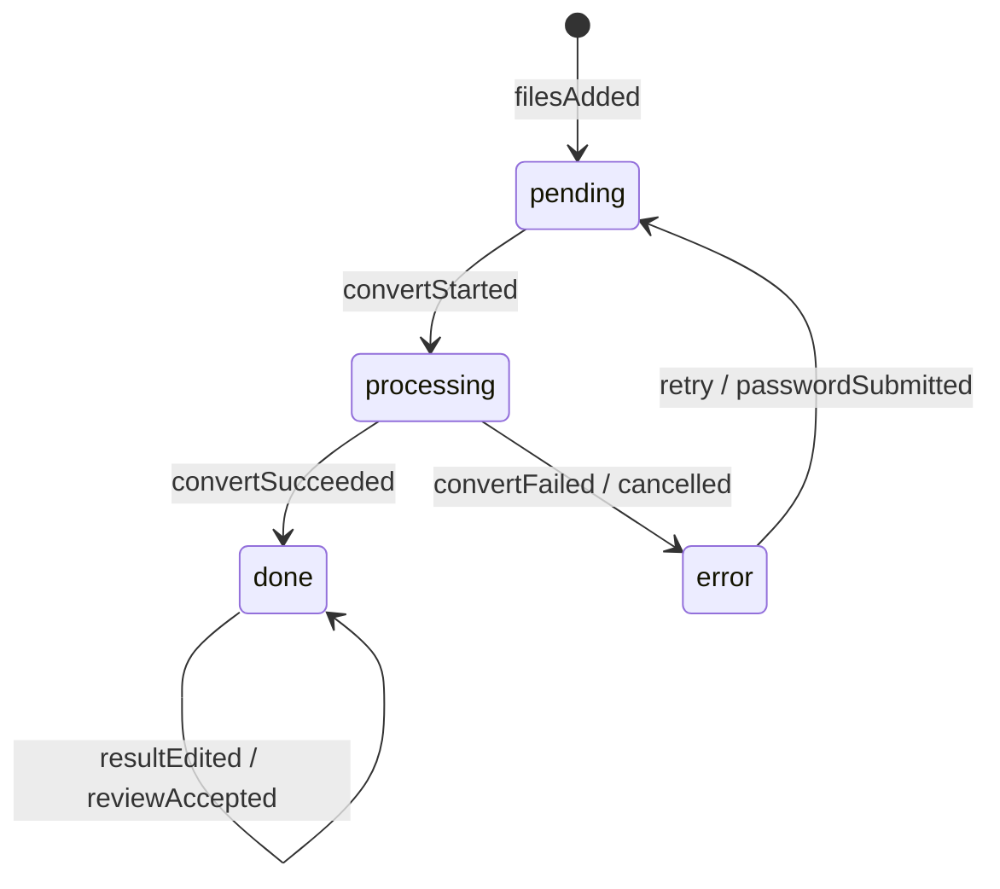

# 4. Frontend

Angular 22 (komponenty standalone, sygnały), NgRx (store + effects + entity), Tailwind 4,
Storybook dla komponentów UI. Serwowany przez nginx z tego samego originu co `/api/`,
więc w produkcji nie ma CORS.

## Widoki

| Trasa | Komponent | Ładowanie | Co robi |
|---|---|---|---|
| `/login` | `features/login/login-page` | od razu | logowanie, rejestracja (gdy `GET /auth/options` ją zgłasza) |
| `/import` | `features/import/import-page` | od razu | kolejka plików, postęp, hasła do dokumentów, pobranie wyników (pojedynczo albo ZIP) |
| `/result/:id` | `features/result/result-page` | lazy | zakładki: podgląd formularza, JSON, raport, edycja |
| `/validator` | `features/validator/validator-page` | lazy | wklejenie JSON-a i sprawdzenie przez `POST /forms/validate` |

Wszystkie trasy poza `/login` mają `authGuard`; `/login` ma `guestGuard`.

## Struktura

```
src/app/
├── core/          interceptory HTTP, guardy, mapowanie błędów API na komunikaty, tytuły stron
├── store/
│   ├── auth/          token, użytkownik, wygaśnięcie; zapis w sessionStorage
│   └── import-queue/  kolejka konwersji (EntityState<QueueItem>)
├── features/
│   ├── import/    import-page, rejestr plików, walidacja po stronie klienta, ZIP wyników
│   ├── preview/   renderer formularza COI (działający podgląd)
│   ├── result/    strona wyniku: raport, lista „do sprawdzenia”, edytor formularza
│   ├── validator/ walidator JSON
│   └── login/
└── shared/
    ├── api/       klient wygenerowany z OpenAPI – nie edytować ręcznie
    └── ui/        komponenty bazowe (button, card, badge, combobox, file-drop, …) + stories
```

## Kontrakt z API

`shared/api/` generuje `ng-openapi-gen` z `docs/openapi.json`, a ten plik eksportuje
`scripts/export-openapi.py` z działającej aplikacji FastAPI:

```
backend (FastAPI) ──export-openapi.py──▶ docs/openapi.json ──ng-openapi-gen──▶ frontend/src/app/shared/api/
```

`npm run api:check` regeneruje oba i kończy się błędem, jeśli coś różni się od wersji
w repozytorium. Zmiana kształtu odpowiedzi w backendzie wymaga więc `npm run api:generate`
i commitu wyniku.

Wyjątek: `/forms/convert` jest wywoływany ręcznie (`features/import/convert-file.http.ts`),
bo ciało multipart jest opisane w OpenAPI przez `openapi_extra`, a nie przez parametr.
Wywołanie stoi za tokenem `CONVERT_FILE`, więc demo bez backendu podstawia
`provideMockConvertFile()` z przykładowymi formularzami.

## Stan

### `auth`

Token, `expiresAt`, nazwa użytkownika. Meta-reducer `auth.storage.ts` zapisuje sesję
w `sessionStorage` (`coi-cf.auth`) i odtwarza ją przy starcie, odrzucając wygasłą.
`AuthEffects.expiryTimer$` wylogowuje w chwili wygaśnięcia tokenu.

Interceptory (`core/`):

- `authInterceptor` dokłada `Authorization: Bearer` tylko do żądań `/api/*` (poza
  `/auth/token`);
- `errorInterceptor` na pierwsze 401 z własnego API wysyła `logout({reason: 'unauthorized'})`.
  Kolejne 401 są ignorowane, bo token jest już wyczyszczony.

### `importQueue`

Każdy plik to `QueueItem` ze statusem `pending → processing → done | error`.
Reducer pilnuje przejść: akcja dla elementu w złym stanie jest ignorowana, więc spóźniony
wynik anulowanej konwersji niczego nie „ożywi”.



`ImportQueueEffects`:

- **`schedule$`** – po każdej zmianie kolejki startuje tyle elementów `pending`, ile
  brakuje do `BATCH_CONCURRENCY = 2` (tyle samo co domyślne `MAX_CONCURRENT_JOBS` w API).
  Decyzja zapada po opróżnieniu kolejki dispatchy (`observeOn(asapScheduler)`) – inaczej
  zdarzały się podwójne starty. Bez tokenu nic nie startuje; kolejka czeka na `loginSuccess`.
- **`convert$`** – wysyła plik, a przerywa żądanie na `cancelled` dla tego elementu,
  na wyczyszczenie kolejki i na ręczne wylogowanie. Odpowiedź
  `DOCUMENT_PASSWORD_REQUIRED` / `_INVALID` ustawia `passwordState`; odrzucone hasło jest
  usuwane i nigdy nie jest wysyłane ponownie.
- **`session$`** – kolejka należy do użytkownika. Logowanie innego użytkownika w tej samej
  karcie ją czyści; ponowne zalogowanie tego samego (np. po wygaśnięciu tokenu) ją zachowuje.

## Dane w przeglądarce

| Dane | Gdzie | Dlaczego tam |
|---|---|---|
| JWT, nazwa użytkownika | `sessionStorage` | przetrwa odświeżenie karty, znika z jej zamknięciem |
| obiekty `File`, hasła do dokumentów | `FileRegistry` (Map w pamięci) | nieserializowalne; hasła nie mogą trafić do DevTools ani `sessionStorage` |
| wyniki i raporty | store NgRx (pamięć) | dane osobowe z dokumentu; nie są zapisywane trwale |

Store DevTools są włączone tylko w trybie deweloperskim, z sanitizerami usuwającymi token.

## Podgląd formularza (`features/preview/`)

`FormRenderer` wyświetla JSON w formacie importu COI jako działający formularz krok po
kroku – po to, żeby urzędnik sprawdził wynik bez importu do Generatora.

- **Kolejność stron i pól**: `page-order.ts` (z `flow` i `questionOrder`), siatka
  `x/y/rows/cols`: `renderer-grid.ts`.
- **Pola**: jeden komponent na typ COI w `fields/` (`text`, `textarea`, `date`, `radio`,
  `select`, `checkbox`, `file-uploader`, `section`, `consent-section`, `text-block`,
  `dictionary-cascade`), `unknown` dla typów spoza listy. `field-host.ts` wybiera komponent.
- **Odpowiedzi**: `AnswersStore` (sygnały). Dane inicjalne `EXTERNAL_SYSTEM` wypełnia
  przykładowymi wartościami z `sample-registry-data.ts`.
- **Widoczność**: `visibility.ts` wykonuje zapytania JSONata ze `states` (biblioteka
  `jsonata`). Zasada *fail-open*: zapytanie, które się nie kompiluje albo rzuca, nie ukrywa
  pola – tylko loguje ostrzeżenie. Skompilowane zapytania są cache'owane.
- **Walidacja kroku**: `validators.ts`, `validate-step.ts` (wymagalność, PESEL, NIP, kod
  pocztowy, e-mail…).
- **Słowniki**: TERYT z `GET /dictionaries/teryt` (pobierany raz, przy pierwszym użyciu),
  kraje i numery kierunkowe lokalnie (`sample-dictionaries.ts`).

Renderer traktuje JSON jako niezaufany: wartości domyślne są rzutowane na tekst, daty
spoza formatu czyszczone, a opisy HTML idą przez wiązanie `[innerHTML]`, które Angular
sanityzuje (usuwa skrypty i atrybuty zdarzeń).

## Strona wyniku (`features/result/`)

- **Raport** (`report-view`, `report.ts`) – metadane konwersji z `report` API.
- **Do sprawdzenia** (`review-panel`) – lista `report.review` (backend stawia pozycje
  o niskiej pewności na początku) z miniaturą strony i położeniem źródła w dokumencie.
  Zaakceptowane pozycje: `reviewAccepted` w store.
- **Edytor** (`form-editor`, `form-edit.ts`, `field-row`, `field-settings`, `add-field`,
  `states-editor`, `consents-editor`, `select-dictionaries`) – zmiana tytułów, typów,
  wymagalności, walidatorów, słowników, warunków widoczności i zgód. Ograniczenia
  edytora odzwierciedlają reguły backendu (np. R13 dla zgód, R14 dla sekcji informacyjnych,
  `ALLOWED_VALIDATORS`). Zapis to `resultEdited`; element dostaje `edited: true`, bo raport
  opisuje już tylko pierwotną konwersję.
- **JSON** (`json-view`) – podgląd i pobranie.

Wynik edycji nie jest wysyłany do API automatycznie. Do sprawdzenia poprawionego formularza
służy `/validator` (`POST /forms/validate`).

## UI i style

Komponenty bazowe w `shared/ui/` mają stories (`*.stories.ts`) z testami dostępności
(`@storybook/addon-a11y`). Tokeny projektowe: `src/styles/tokens.css`, opis w
`tokens.mdx`. Fonty (Open Sans, JetBrains Mono) są w paczce – brak zapytań do CDN, zgodnie
z CSP `default-src 'self'`.
