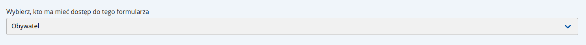
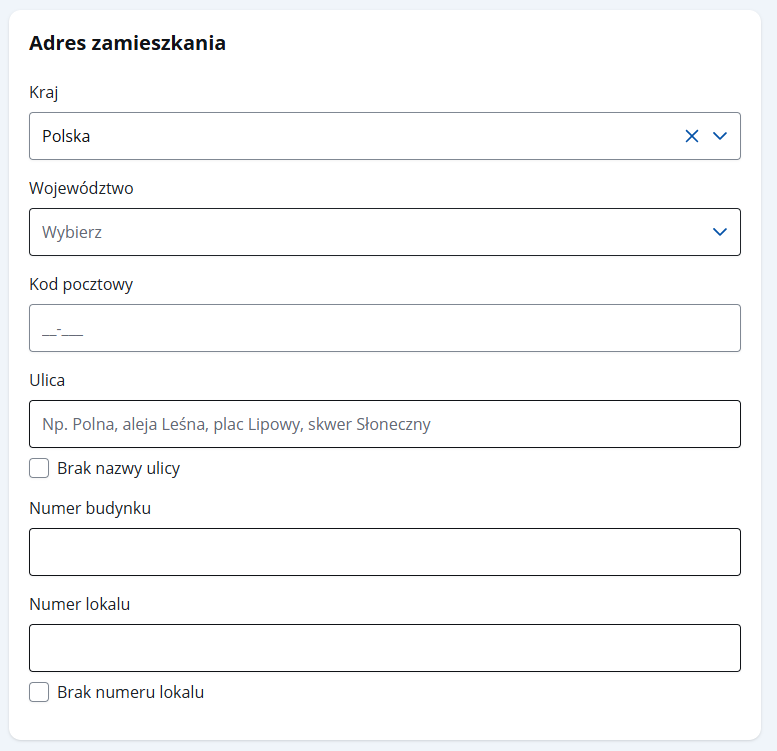
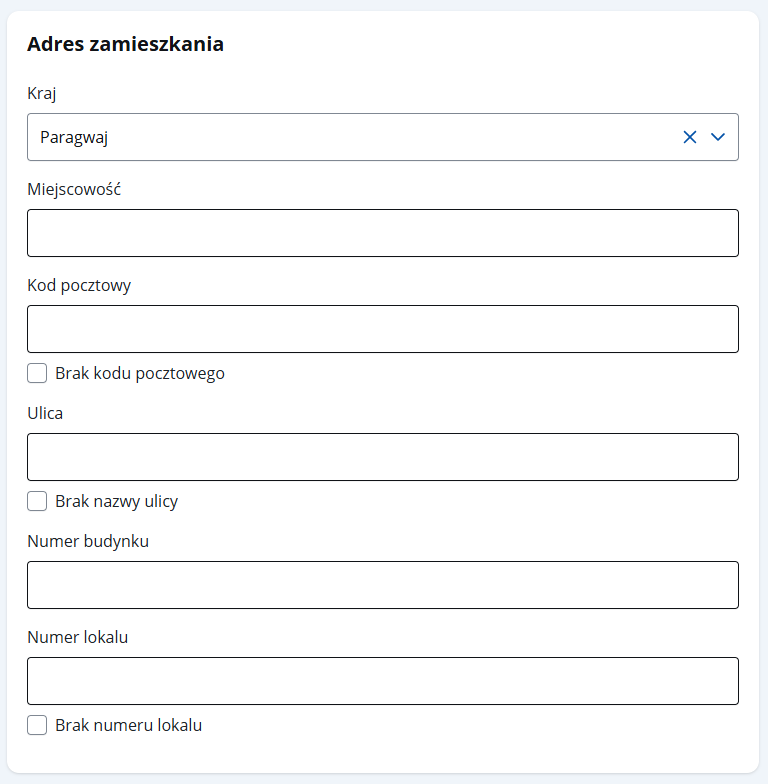
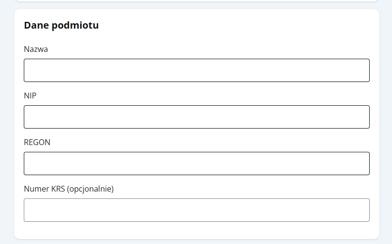
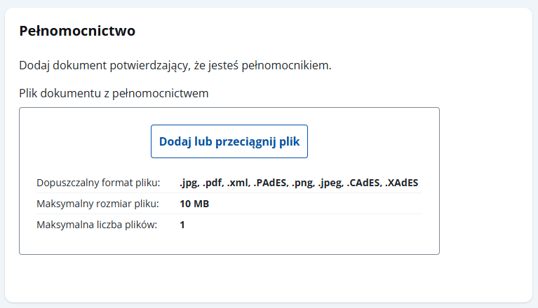
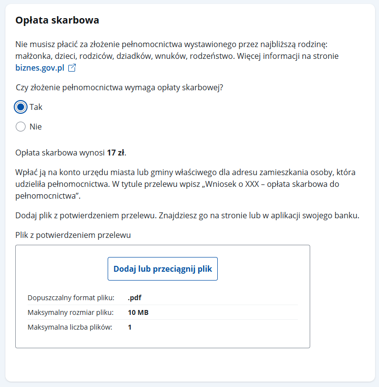
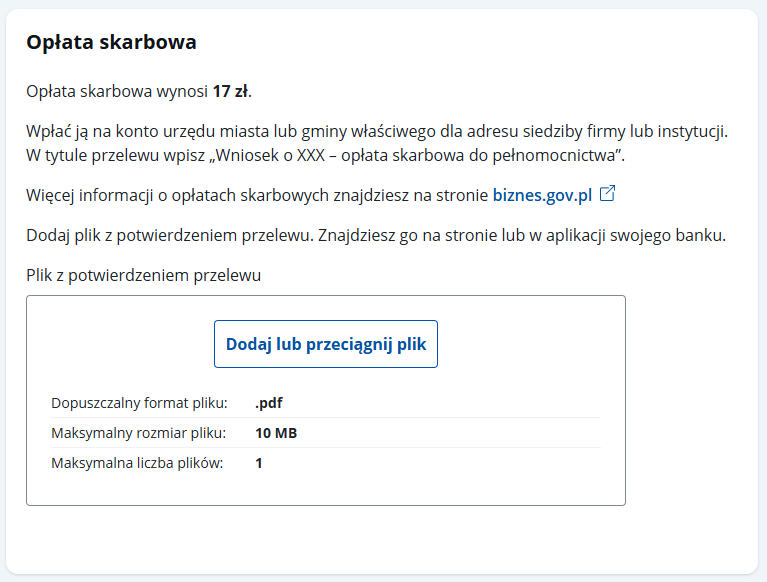
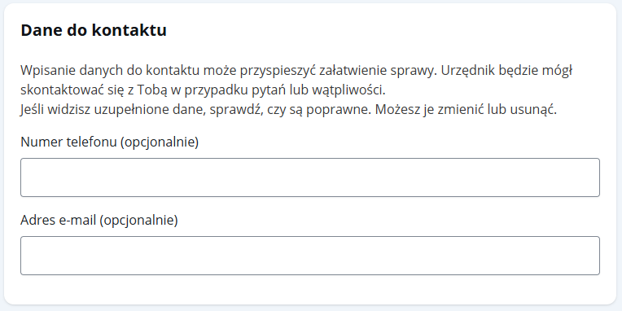

# HackNation. Standardy i dobre praktyki projektowania formularzy

Dokument określa standardy i dobre praktyki projektowania formularzy e-Usług w Generatorze Formularzy. Jego celem jest zapewnienie spójności doświadczeń użytkowników.

## 1. Głos i ton komunikacji z obywatelem

Styl komunikacji wpływa na pierwsze wrażenia użytkowników oraz na to, jak postrzegają oni daną instytucje. Dlatego język formularzy powinien być spójny i pomagać użytkownikom w sprawnym załatwieniu ich spraw.

### Kluczowe cechy dobrej komunikacji

Komunikacja w formularzach powinna być:

- uniwersalna,
- zrozumiała i precyzyjna,
- rzetelna,
- empatyczna.

#### Co to oznacza?

#### Uniwersalność

- Unikaj określania płci odbiorcy.
- Stosuj powszechnie znane i zrozumiałe słowa.
- Rezygnuj z metafor i skomplikowanych porównań.
- Dbaj o dostępność treści dla osób ze szczególnymi potrzebami.

#### Zrozumiałość i precyzja

- Korzystaj z zasad prostego języka i dostępnych narzędzi wspierających jasne pisanie (np. Jasnopis, Logios).
- Wyjaśniaj trudniejsze pojęcia i w razie potrzeby podawaj szerszy kontekst.

#### Rzetelność

- Przekazuj pełne i dokładne informacje, nawet jeśli niektóre mogą być niekorzystne dla użytkownika.
- Unikaj treści marketingowych i nadmiernej perswazji.

#### Empatia

- Przewiduj emocje użytkownika i formułuj komunikaty tak, by były dla niego pomocne.
- Stosuj wskazówki, które ułatwią użytkownikowi poprawne wypełnienie formularza.

### Zasady tworzenia poprawnych komunikatów

Przejrzyste i zrozumiałe komunikaty w administracji publicznej ułatwiają obywatelom załatwianie spraw oraz budują zaufanie do instytucji państwowych. Dobrze sformułowane treści powinny być proste, konkretne i dostosowane do potrzeb odbiorców.

Te zasady pomogą w tworzeniu skutecznych komunikatów.

- Twórz krótkie zdania – jedna myśl na jedno zdanie.
- Zachowuj naturalny szyk zdania (najpierw rzeczownik, potem czasownik), np. Nieprawidłowe zdjęcie może być powodem odrzucenia wniosku.
- Używaj strony czynnej i osobowej, aby jasno wskazywać, kto powinien wykonać daną czynność. Na przykład: Status zgłoszenia możesz sprawdzić w zakładce Twoje sprawy.
- Unikaj trudnych słów, stosuj proste i powszechnie znane określenia.
- Unikaj skrótów, których nie wyjaśniasz. Jeśli musisz ich użyć, podaj ich wyjaśnienie gdy nie jest powszechnie znane.
- Porządkuj tekst wizualnie, stosuj punktory i akapity.
- Ograniczaj liczbę szczegółów, przekazuj tylko te informacje, które są niezbędne.
- Dbaj o poprawność językową i gramatyczną.

### Błędy, których warto unikać

W administracji publicznej kluczowe jest unikanie nieprecyzyjnych, skomplikowanych i nieprzystępnych sformułowań, które mogą utrudniać użytkownikom zrozumienie przekazu.

Poniżej znajduje się lista najczęściej popełnianych błędów, których warto unikać w komunikacji z obywatelami.

1. Skomplikowane terminy prawne – jeśli musisz ich użyć, dodaj wyjaśnienie.
2. Długie i trudne słowa – najlepiej unikać wyrazów o więcej niż czterech sylabach.
3. Bezosobowe formy czasowników, np. nie otrzymano, naliczono opłatę.
4. Zbędne wyrażenia, np. informujemy, w odniesieniu do powyższego, pragniemy nadmienić.
5. Zbyt dużo wtrąceń – zaburzają czytelność.
6. Pretensjonalne zwroty, np. dokonać, pragnąć, posiadać.
7. Nadmierne użycie form analitycznych, np. dokonać weryfikacji zamiast zweryfikować.
8. Imiesłowy zakończone na –ąc, np. wnioskując, informując.
9. Czas przeszły, który może sprawiać trudności w zachowaniu neutralności płciowej.

Dzięki stosowaniu tych zasad komunikacja w e-usługach stanie się bardziej przejrzysta, użytkownicy będą mogli sprawniej załatwiać swoje sprawy, a administracja zyska w ich oczach jako instytucja przyjazna i profesjonalna.

## 2. Projektowanie formularza

### Ogólne zasady

Przy projektowaniu formularza jako całości stosuj się do ogólnych zasad:

1. Projektuj formularze zgodnie z zasadami dostępności cyfrowej – zapewnij zgodność z wymaganiami WCAG 2.1 na poziomie AA
2. Stosuj układ jednokolumnowy – formularze powinny być czytelne i łatwe do zeskanowania wzrokiem. Układ jednokolumnowy jest bardziej intuicyjny dla użytkowników oraz lepiej wspiera technologie asystujące, takie jak czytniki ekranu.
3. Grupuj pola w tematycznych sekcjach – każda sekcja powinna obejmować pola, które są ze sobą tematycznie powiązane. Dzięki temu użytkownik łatwiej zrozumie strukturę formularza.
4. Dobieraj typ pola do rodzaju zbieranych danych zgodnie z poniższymi zasadami:
   - a. Krótkie pole tekstowe (ang. input field) – do wpisywania krótkiego tekstu, złożonego z jednego wiersza.
   - b. Długie pole opisowe (ang. textarea) – do wpisywania większej ilości tekstu, zazwyczaj zajmującego kilka wierszy, np. uzasadnienia, opisu sytuacji lub dodatkowych wyjaśnień.
   - c. Pole numeryczne – do wprowadzania wyłącznie wartości liczbowych.
   - d. Pole jednokrotnego wyboru (ang. radio buttons) – stosuj, gdy użytkownik może wybrać tylko jedną opcję z listy.
   - e. Pole wielokrotnego wyboru (ang. checkboxes) – stosuj, gdy użytkownik powinien wybrać co najmniej jedną opcję z listy.
   - f. Lista rozwijana (ang. dropdown) – stosuj, gdy liczba dostępnych opcji jest większa niż 5 i ich jednoczesne wyświetlenie utrudniałoby korzystanie z formularza. Gdy użytkownik może wybrać tylko jedną opcję z listy, stosuj listy jednokrotnego wyboru, a gdy jedną lub więcej opcji – listy wielokrotnego wyboru. Jeżeli opcji jest więcej niż 15, zastosuj wyszukiwarkę.
   - g. Pole daty – wykorzystuj do wprowadzania dat.
   - h. Przesyłanie plików - stosuj, gdy użytkownik musi dołączyć dokumenty, załączniki lub inne pliki niezbędne do realizacji sprawy. Określ dopuszczalne formaty i maksymalny rozmiar pliku.
   - i. Sekcja zgód - stosuj, gdy użytkownik musi wyrazić zgodę na określone warunki np. regulamin, politykę prywatności itp. Nie używaj do dodawania zgód pól wielokrotnego wyboru.
   - j. Blok tekstu – stosuj, gdy chcesz umieścić na formularzu fragment tekstu, którego użytkownik nie będzie mógł edytować i nie jest to opis dla konkretnego pola – jeżeli jest, korzystaj z opisu w ramach pola, którego opis dotyczy. Unikaj ściany tekstu.
5. Stosuj walidacje danych – weryfikuj poprawność danych już na etapie ich wprowadzania.
6. Korzystaj z danych dostępnych w rejestrach – jeżeli dane mogą zostać pobrane automatycznie z rejestrów, nie wymagaj ich wpisywania przez użytkownika.
7. Pokazuj tylko te pola, które są potrzebne na danym etapie – nie wszystkie pola muszą być widoczne od razu. Część pól może być widoczna dopiero po wybraniu określonej opcji.
8. Wykorzystuj strony alternatywne. Jeśli zmiana dotyczy pojedynczego pola lub niewielkiej grupy pól, pokaż lub ukryj tylko te elementy. Jeżeli natomiast od odpowiedzi użytkownika zależy cały kolejny etap formularza lub rozbudowany zestaw pól, zastosuj strony alternatywne.
9. Korzystaj z sekcji powtarzających się – gdy zbierasz te same dane dla wielu osób, nieruchomości, pojazdów lub innych powtarzalnych elementów.
10. Korzystaj z sekcji predefiniowanych opisanych w niniejszym dokumencie – zapewnia to spójność formularzy oraz ogranicza konieczność każdorazowego projektowania tych samych elementów od podstaw.
11. Zachowuj logiczną kolejność zbierania danych. Formularz powinien prowadzić użytkownika przez kolejne etapy przekazywania informacji:
   - a. Dane stron postępowania (adresat, wnioskodawca, pełnomocnik).
   - b. Informacje dotyczące sprawy.
   - c. Dane kontaktowe i wymagane oświadczenia.
   - d. Podsumowanie oraz podgląd formularza przed wysłaniem.
12. Tam, gdzie jest to możliwe, zastosuj w formularzu nawigację.

### Budowa formularza

Poniżej znajdują się wytyczne odnośnie budowy poszczególnych elementów formularza elektronicznego, aby zachowywał on standard organizacji. Wytyczne tworzone są w oparciu o założenie, że do formularza dostęp ma jedynie obywatel – nie ma możliwosci na ten moment logowania się i wypełniania formularza w kontekscie firmy lub instytucji.

#### Tytuł

Pierwszym krokiem przy tworzeniu formularza jest nadanie mu odpowiedniego tytułu.

Powinien on jasno wskazywać na cel formularza.

Tytuł formularza zwykle powinien się zaczynać od słowa:

- Wniosek,
- Zgłoszenie,
- Deklaracja,
- Oświadczenie.

Następna powinna być informacja, czego dotyczy, na przykład:

- Wniosek o zwolnienie z obowiązku budowy kanału technologicznego,
- Wniosek o zezwolenie na usunięcie drzewa lub krzewu,
- Zgłoszenie urodzenia dziecka.

Tytuł powinien być jak najkrótszy. Nie umieszczaj w tytule odwołań do przepisów prawa.

#### Urząd, do którego jest składany wniosek

Na górze pierwszej strony, umieść sekcję zawierającą dane urzędu, do którego zostanie przekazane pismo.

**Konfiguracja sekcji:**

- Tytuł sekcji: Urząd, do którego jest składany wniosek
- Zawartość:
  - pole tekstowe z etykietą „Nazwa urzędu”
    - wartość domyślna: nazwa urzędu oraz właściwej komórki organizacyjnej (np. wydziału),
    - pole tylko do odczytu
- Jeżeli formularz jest adresowany do organu a nie do urzędu np. Do Wójta, wtedy etykieta to “Nazwa organu” a tytułem sekcji jest “Organ, do którego jest składany wniosek”.

#### Podmiot wniosku

Po wskazaniu adresata umieść dane wnioskodawcy.

Jeżeli formularz dopuszcza działanie w imieniu innej osoby lub podmiotu, dodaj sekcję „Podmiot wniosku”.  Jeżeli można wnioskować tylko we własnym imieniu - pomiń tę sekcję.

**Konfiguracja sekcji:**

- Tytuł sekcji: Podmiot wniosku
- Zawartość:
  - pole radio z etykietą „Wybierz, w czyim imieniu wnioskujesz”
    - Opcje wyboru
      - Swoim
      - Innej osoby
      - Osoby prawnej lub jednostki organizacyjnej
    - Walidacja: pole wymagane
  - pole radio z etykietą 'Wybierz, jako kto wnioskujesz / zgłaszasz / deklarujesz'
    - Opcje wyboru
      - Pełnomocnik
      - Reprezentant
    - Walidacja: pole wymagane
    - Widoczność: pole widoczne, jeżeli użytkownik w polu Wybierz, w czyim imieniu wnioskujesz wybrał opcję 'Osoby prawnej lub jednostki organizacyjnej'

Ważne: Powyższe opcje nie są stałe. Należy je dostosować do tego, kto może złożyć dany wniosek. Informację tę można zazwyczaj ustalić na podstawie formularza papierowego, sprawdzając, jakie dane są wymagane od wnioskodawcy.

- Jeśli formularz przewiduje wyłącznie dane osoby fizycznej i nie zawiera danych dotyczących firmy ani instytucji, w formularzu elektronicznym należy umożliwić złożenie wniosku w swoim imieniu lub w imieniu innej osoby.
- Jeśli formularz przewiduje wyłącznie dane firmy lub instytucji, należy umożliwić podanie danych podmiotu, w którego imieniu działa osoba składająca wniosek.
- Jeśli formularz przewiduje zarówno dane osoby fizycznej, jak i firmy lub instytucji, należy udostępnić wszystkie możliwości: złożenie wniosku w swoim imieniu, w imieniu innej osoby oraz w imieniu firmy lub instytucji.

#### Twoje dane

Sekcja „Twoje dane” jest obowiązkowa. Służy do wskazania osoby, która faktycznie wypełnia formularz i składa wniosek. Dane prezentowane w tej sekcji są automatycznie pobierane z rejestru użytkowników i nie mogą być edytowane przez wypełniającego.

**Konfiguracja sekcji:**

- Tytuł sekcji: Twoje dane
- Zawartość:
  - pole tekstowe z etykietą „Imię”
    - Walidacja: pole wymagane
    - Źródło danych inicjalnych: Dane zalogowanego użytkownika
    - Pole będące źródłem danych: Imię z MLPZ
    - Pole tylko do odczytu
  - pole tekstowe z etykietą 'Nazwisko'
    - Walidacja: pole wymagane
    - Źródło danych inicjalnych: Dane zalogowanego użytkownika
    - Pole będące źródłem danych: Nazwisko z MLPZ
    - Pole tylko do odczytu
  - Pole tekstowe z etykietą 'Numer PESEL'
    - Walidacja: pole wymagane
    - Dodatkowe walidatory: PESEL
    - Źródło danych inicjalnych: Dane zalogowanego użytkownika
    - Pole będące źródłem danych: Wartość PESEL z MLPZ
    - Pole tylko do odczytu

#### Adres

Adres zamieszkania, zameldowania, korespondencji oraz siedziby należy budować według jednolitego schematu, wykorzystując te same pola i prezentując je w tej samej kolejności.

Dla adresu w Polsce zbieramy następujące dane: kraj, województwo, powiat, gmina, miejscowość, kod pocztowy, ulica, numer budynku, numer lokalu.

W powyższym przykładzie, województwo, powiat, gmina, miejscowość są elementami zależymi, następującymi po sobie, wybieranymi z listy.

Dla adresu spoza Polski - kraj, miejscowość, kod pocztowy bez walidacji, ulica, numer budynku, numer lokalu.

**Konfiguracja sekcji:**

- Tytuł sekcji: Adres zamieszkania/zameldowania/siedziby/korespondencyjny
- Zawartość:
  - pole typu lista rozwijana z etykietą „Kraj”
    - Włączone pole do wyszukiwania
    - Zaimportowany słownik: Kraje
    - wartość domyślna: Polska
    - walidacja: pole wymagane.
  - Pole tekstowe z etykietą 'Miejscowość'
    - Widoczność: pole widoczne, jeżeli użytkownik w polu 'Kraj' wybrał opcję inną niż 'Polska'
    - walidacja: pole wymagane
  - Pole tekstowe z etykietą 'Kod pocztowy'
    - Włączona opcja 'Wyświetl dodatkowy checkbox wyłączający pole' z etykietą 'Brak kodu pocztowego'
    - Widoczność: pole widoczne, jeżeli użytkownik w polu Kraj wybrał opcję inną niż 'Polska'
    - walidacja: pole wymagane
  - Pole tekstowe z etykietą 'Ulica'
    - Włączona opcja 'Wyświetl dodatkowy checkbox wyłączający pole' z etykietą 'Brak nazwy ulicy'
    - Widoczność: pole widoczne, jeżeli użytkownik w polu Kraj wybrał opcję inną niż 'Polska'
    - walidacja: pole wymagane
  - pole typu lista rozwijana
    - Włączone pole do wyszukiwania
    - Zaimportowany słownik: TERYT_4G_DOWODOWY
    - wartość domyślna: Polska
    - walidacja: pole wymagane.
    - Widoczność: pole widoczne, jeżeli użytkownik w polu Kraj wybrał opcję 'Polska'
  - Pole tekstowe z etykietą 'Kod pocztowy'
    - Widoczność: pole widoczne, jeżeli użytkownik w polu Kraj wybrał opcję 'Polska'
    - walidacja: pole wymagane
    - Dodatkowa walidacja: Kod pocztowy
    - Tekst zastępczy (placeholder): __-___
    - Źródło danych inicjalnych: Dane zalogowanego użytkownika
    - Pole będące źródłem danych: Kod pocztowy z MLPZ
  - Pole tekstowe z etykietą 'Ulica'
    - Widoczność: pole widoczne, jeżeli użytkownik w polu Kraj wybrał opcję 'Polska'
    - walidacja: pole wymagane
    - Dodatkowa walidacja: Kod pocztowy
    - Tekst zastępczy (placeholder): Np. Polna, Aleja Leśna, Plac Lipowy, Skwer Słoneczny
    - Źródło danych inicjalnych: Dane zalogowanego użytkownika
    - Pole będące źródłem danych: Ulica z MLPZ
    - Włączona opcja 'Wyświetl dodatkowy checkbox wyłączający pole' z etykietą 'Brak nazwy ulicy'
  - Pole tekstowe z etykietą 'Numer budynku'
    - Widoczność: pole widoczne, jeżeli użytkownik w polu Kraj wybrał opcję 'Polska'
    - walidacja: pole wymagane
    - Źródło danych inicjalnych: Dane zalogowanego użytkownika
    - Pole będące źródłem danych: Nr budynku z MLPZ
  - Pole tekstowe z etykietą 'Numer lokalu'
    - Widoczność: pole widoczne, jeżeli użytkownik w polu Kraj wybrał opcję 'Polska'
    - walidacja: pole wymagane
    - Źródło danych inicjalnych: Dane zalogowanego użytkownika
    - Pole będące źródłem danych: Nr lokalu z MLPZ
    - Włączona opcja 'Wyświetl dodatkowy checkbox wyłączający pole' z etykietą 'Brak numeru lokalu'

#### Dane innej osoby

Jeżeli formularz dopuszcza działanie w imieniu innej osoby, dodaj sekcję 'Dane innej osoby'. Widoczność całej sekcji uzależnij od wyboru opcji 'Innej osoby' w sekcji 'Podmiot wniosku'.

**Konfiguracja sekcji:**

- Tytuł sekcji: Dane innej osoby
- Zawartość:
  - pole tekstowe z etykietą „Imię”
    - Walidacja: pole wymagane
  - pole tekstowe z etykietą 'Nazwisko'
    - Walidacja: pole wymagane
  - Pole tekstowe z etykietą 'Numer PESEL'
    - Walidacja: pole wymagane

#### Dane podmiotu

Jeżeli formularz dopuszcza działanie w imieniu innego podmiotu, dodaj sekcję 'Dane podmiotu'. Widoczność całej sekcji uzależnij od wyboru opcji 'Osoby prawnej lub jednostki organizacyjnej' w sekcji 'Podmiot wniosku'.

**Konfiguracja sekcji:**

- Tytuł sekcji: Dane podmiotu
- Widoczność: sekcja widoczna, jeżeli użytkownik w sekcji 'Dane podmiotu' w polu 'Wybierz, w czyim imieniu wnioskujesz' wybrał opcję 'Osoby prawnej lub jednostki organizacyjnej'
- Zawartość:
  - Pole tekstowe z etykietą 'Nazwa'
    - walidacja: pole wymagane
  - Pole tekstowe z etykietą 'NIP'
    - walidacja: pole wymagane
    - Dodatkowe walidatory: NIP
  - Pole tekstowe z etykietą 'REGON'
    - walidacja: pole wymagane
    - Dodatkowe walidatory: REGON
  - Pole tekstowe z etykietą 'Numer KRS'
    - walidacja: pole opcjonalne
    - Dodatkowe walidatory: Pattern
    - Regex: ^\d{10}$
    - Komunikat walidacyjny: Wpisz 10 cyfr.

#### Pełnomocnictwo

Jeżeli formularz dopuszcza działanie w imieniu innej osoby lub innego podmiotu w charakterze pełnomocnika, dodaj sekcję 'Pełnomocnictwo'. Widoczność całej sekcji uzależnij od wyboru opcji 'Innej osoby' lub 'Osoby prawnej lub jednostki organizacyjnej' oraz 'Pełnomocnik' w sekcji 'Podmiot wniosku'.

**Konfiguracja sekcji:**

- Tytuł sekcji: Pełnomocnictwo
- Widoczność: sekcja widoczna, jeżeli użytkownik w sekcji 'Dane podmiotu' w polu 'Wybierz, w czyim imieniu wnioskujesz' wybrał opcję 'Innej osoby' lub 'Osoby prawnej lub jednostki organizacyjnej' oraz 'Pełnomocnik'
- Opis sekcji: Dodaj dokument potwierdzający, że jesteś pełnomocnikiem.
- Zawartość:
  - Pole przesyłanie plików z etykietą 'Plik dokumentu z pełnomocnictwem'
    - walidacja: pole wymagane
    - Maksymalna liczba plików: 1
    - Maksymalny rozmiar pliku: 10 MB
    - Dostępne formaty plików: jpg, pdf, xml, PAdES, png, jpeg, CAdES, XAdES

#### Opłata skarbowa (wersja 1)

Jeżeli formularz dopuszcza działanie w imieniu innej osoby, dodaj sekcję 'Opłata skarbowa'. Widoczność całej sekcji uzależnij od wyboru opcji 'Innej osoby' w sekcji 'Podmiot wniosku'.

**Konfiguracja sekcji:**

- Tytuł sekcji: Opłata skarbowa
- Widoczność: sekcja widoczna, jeżeli użytkownik w sekcji 'Dane podmiotu' w polu 'Wybierz, w czyim imieniu wnioskujesz' wybrał opcję 'Innej osoby'.
- Opis sekcji: Nie musisz płacić za złożenie pełnomocnictwa wystawionego przez najbliższą rodzinę: małżonka, dzieci, rodziców, dziadków, wnuków, rodzeństwo. Więcej informacji na stronie biznes.gov.pl
- Zawartość:
  - Pole radio z etykietą 'Czy złożenie pełnomocnictwa wymaga opłaty skarbowej?'
    - walidacja: pole wymagane
    - Opcje
      - Tak
      - Nie
  - Pole blok tekstu
    - Opis: Opłata skarbowa wynosi 17 zł.

      Przelej ją na konto urzędu miasta lub gminy właściwego dla adresu zamieszkania osoby, która udzieliła pełnomocnictwa. Jeśli adres nie jest w Polsce, opłatę przelej na konto Urzędu Miasta Stołecznego Warszawy – Centrum Obsługi Podatnika.

      W tytule przelewu wpisz „Wniosek o (...) – opłata skarbowa za pełnomocnictwo”.

      Dodaj plik z potwierdzeniem przelewu. Znajdziesz go na stronie lub w aplikacji swojego banku.
    - Widoczność: pole widoczne jeżeli na pytanie 'Czy złożenie pełnomocnictwa wymaga opłaty skarbowej? z sekcji 'Opłata skarbowa' wybrano odpowiedź 'Tak'
  - Pole przesyłanie plików z etykietą 'Plik z potwierdzeniem przelewu'
    - Walidacja: pole wymagane
    - Maksymalna liczba plików: 1
    - Maksymalny rozmiar: 10 MB
    - Dostępne formaty: PDF
    - Widoczność: pole widoczne jeżeli na pytanie 'Czy złożenie pełnomocnictwa wymaga opłaty skarbowej? z sekcji 'Opłata skarbowa' wybrano odpowiedź 'Tak'

#### Opłata skarbowa (wersja 2)

Jeżeli formularz dopuszcza działanie w imieniu innego podmiotu w charakterze pełnomocnika, dodaj sekcję 'Opłata skarbowa'. Widoczność całej sekcji uzależnij od wyboru opcji 'Osoby prawnej lub jednostki organizacyjnej' oraz 'Pełnomocnik' w sekcji 'Podmiot wniosku'.

**Konfiguracja sekcji:**

- Tytuł sekcji: Opłata skarbowa
- Widoczność: sekcja widoczna, jeżeli użytkownik w sekcji 'Dane podmiotu' w polu 'Wybierz, w czyim imieniu wnioskujesz' wybrał 'Osoby prawnej lub jednostki organizacyjnej' oraz 'Pełnomocnik'.
- Zawartość:
  - Pole blok tekstu
    - Opis: Opłata skarbowa wynosi 17 zł.

      Przelej ją na konto urzędu miasta lub gminy właściwego dla adresu zamieszkania osoby, która udzieliła pełnomocnictwa. Jeśli adres nie jest w Polsce, opłatę przelej na konto Urzędu Miasta Stołecznego Warszawy – Centrum Obsługi Podatnika.

      W tytule przelewu wpisz „Wniosek o (...) – opłata skarbowa za pełnomocnictwo”.

      Dodaj plik z potwierdzeniem przelewu. Znajdziesz go na stronie lub w aplikacji swojego banku.
  - Pole przesyłanie plików z etykietą 'Plik z potwierdzeniem przelewu'
    - Walidacja: pole wymagane
    - Maksymalna liczba plików: 1
    - Maksymalny rozmiar: 10 MB
    - Dostępne formaty: PDF

#### Druga i kolejne strony - Przedmiot wniosku

Kolejne strony zaprojektuj zgodnie z wymaganiami danego formularza. Pamiętaj o stosowaniu wszystkich wcześniej opisanych wytycznych odnośnie tematyczności sekcji itd. Możesz nazwać tę stronę również w sposób tożsamy z danymi, które są na niej zawarte.

#### Przedostatnia strona formularza – kontakt z urzędem, opłaty, zgody

Zgodnie z dobrymi praktykami tworzenia formularzy mObywatel na przedostatniej stronie formularza zawarte są dane związane z kontaktem obywatela z urzędem, opłaty skarbowe i oświadczenia oraz zgody. W tym miejscu należy zebrać wszystkie elementy formalne, które nie zostały uwzględnione na wcześniejszych etapach wypełniania wniosku.

#### Dane do kontaktu

Należy zamieścić również sekcję 'Dane do kontaktu',

**Konfiguracja sekcji:**

- Tytuł sekcji: Dane do kontaktu
- Opis sekcji: Wpisanie danych do kontaktu może przyspieszyć załatwienie sprawy. Urzędnik będzie mógł skontaktować się z Tobą w przypadku pytań lub wątpliwości.

  Jeśli widzisz uzupełnione dane, sprawdź, czy są poprawne. Możesz je zmienić lub usunąć.

- Zawartość:
  - pole tekstowe z etykietą „Numer telefonu”
    - Walidacja: pole nie jest wymagane
    - Źródło danych inicjalnych: Dane zalogowanego użytkownika
    - Pole będące źródłem danych: Numer telefonu z MLPZ
  - pole tekstowe z etykietą „Adres e-mail”
    - Walidacja: pole nie jest wymagane
    - Źródło danych inicjalnych: Dane zalogowanego użytkownika
    - Pole będące źródłem danych: Adres email z MLPZ
    - Dodatkowe walidatory: Email

#### Oświadczenie

Różnego rodzaju zgody i oświadczenia co do zasady umieszczamy na samym końcu formularza. Do zbierania oświadczeń i zgód należy wykorzystywać pole typu „Sekcja zgód”. Nie należy w tym celu używać samodzielnych pól typu pole wyboru checkbox ani radio.

Tytuł sekcji powinien odpowiadać jej zawartości.

Jeżeli sekcja zawiera wyłącznie oświadczenie:

- Oświadczenie

Jeżeli sekcja zawiera więcej elementów, np. Oświadczenia i jakieś zgody użytkownika:

- Zgody i oświadczenia

Treść oświadczeń i zgód powinna być krótka, jednoznaczna. W miarę możliwości stosuj konstrukcje neutralne językowo. Preferuj formy czasu teraźniejszego, które nie wymagają wskazania płci użytkownika.

Musisz zapewnić użytkownikowi dostęp do pełnej treści klauzuli informacyjnej, z którą deklaruje zapoznanie się ale jednocześnie nie zamieszczać jej na formularzu - zasadą jest niezamieszczanie takich treści na formularzu.

Sposób realizacji obowiązku informacyjnego zależy od podmiotu publicznego. Ważne jest, aby użytkownik miał łatwy dostęp do pełnej treści klauzuli informacyjnej przed wysłaniem wniosku utworzonego za pomocą formularza.

##### Rozwiązanie rekomendowane

Rekomendujemy opublikowanie klauzuli informacyjnej na stronie internetowej urzędu (np. w BIP) oraz zamieszczenie w formularzu odnośnika do tej treści.

Link powinien zawierać opis, czyli krótki tekst, który jednoznacznie wskazuje, dokąd link poprowadzi użytkownika. Na końcu nie stawiaj kropki, tylko dodaj ikonę informującą, że kierujesz użytkownika na inną stronę.

**Konfiguracja sekcji:**

- Tytuł sekcji: Zgoda
- Zawartość:
  - Pole typu sekcja zgód

### Podsumowanie i podgląd

Ostatnia strona formularza nie powinna zawierać pól służących do zbierania danych od użytkownika. Jest ona przeznaczona wyłącznie do prezentacji informacji podsumowujących oraz podglądu przygotowanego dokumentu.

Na tej stronie umieść:

- (opcjonalnie) pole typu blok tekstu zawierające podsumowanie procesu składania wniosku jeżeli należy na koniec o czymś istotnym poinformować użytkownika,
- pole typu blok tekstu informujące o wizualizacji dokumentu,
- podgląd (wizualizację) formularza, generowany na podstawie plików CRWDE.

Przed wysłaniem wniosku użytkownik powinien mieć możliwość zapoznania się z kompletną treścią dokumentu, który zostanie przekazany do urzędu.

#### Podsumowanie

Do sekcji Podsumowanie możesz dodać informacje istotne dla użytkownika. Na przykład jaki będzie dalszy ciąg sprawy, czy ktoś się będzie z nim kontaktować, czy sam musi coś jeszcze zrobić.

**Konfiguracja sekcji:**

- Tytuł sekcji: Podsumowanie
- Zawartość:
  - Pole typu blok tekstu
  - Treść zależna od sytuacji.

#### Podgląd

- Jeśli formularz kończy się podpisem – zostaw ten opis (domyślnie zakładamy, że każdy formularz kończy się podpisem elektronicznym w ramach zadania).

  Zanim przejdziesz do wyboru sposobu podpisu, sprawdź dane na podglądzie. Jeśli zobaczysz błędy, wróć do edycji.

- Jeśli nie ma podpisu – zostaw ten opis.

  Zanim wyślesz formularz, sprawdź dane na podglądzie. Jeśli zobaczysz błędy, wróć do edycji.

**Konfiguracja sekcji:**

- Tytuł sekcji: Podgląd
- Zawartość:
  - Pole typu blok tekstu.
  - Tekst jak powyżej w bloku tekstu.

#### Wizualizacja

Przed wysłaniem wniosku użytkownik powinien mieć możliwość zapoznania się z kompletną treścią dokumentu, który zostanie przekazany do urzędu. Wizualizacja powstaje w oparciu o wzór publikowany w Centralnym Repozytorium Wzorów Elektronicznych. Wizualizacja nie jest częścią zadania.
