**Wniosek o stwierdzenie nadpłaty podatku – wizualizacja formularza cyfrowego**

|  |  |  |  |
| --- | --- | --- | --- |
| Lp. | Strona | Formularz | Stany dynamiczne |
| 1 | Formularz „Wniosek o stwierdzenie nadpłaty podatku”, w sekcji Podmiot wniosku zaznaczony radiobutton „Swoim” | 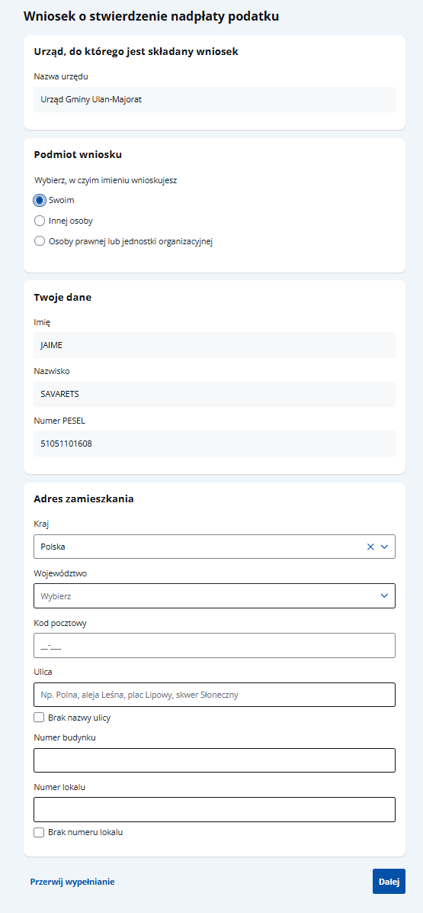 | Jeżeli w polu Podmiot wniosku zostanie wybrana opcja:  a) „Innej osoby” to pod adresem zamieszkania prezentowane są dodatkowe sekcje:  - Dane innej osoby,  - Adres zamieszkania innej osoby,  - Pełnomocnictwo,  - Opłata skarbowa  (screeny w wierszu 2)  b) „Osoby prawnej lub jednostki organizacyjnej”, to:  w sekcji **Podmiot wniosku** prezentowane jest pole typu radiobutton  „Wybierz, jako kto wnioskujesz”, a  pod sekcją Adres zamieszkania prezentowane są dodatkowe sekcje:  - Dane podmiotu  - Adres siedziby  (screeny w wierszu nr 3) |
| 2 | Wniosek o stwierdzenie nadpłaty podatku -  zaznaczona opcja w sekcji Podmiot wniosku = „Innej osoby” | 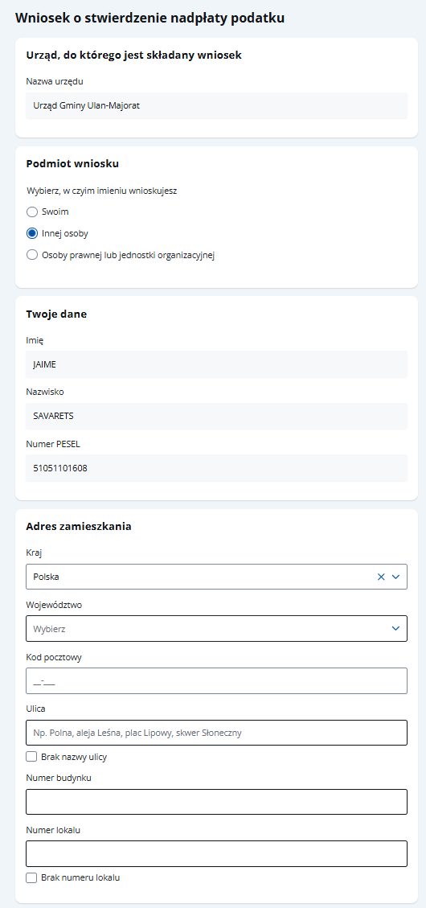  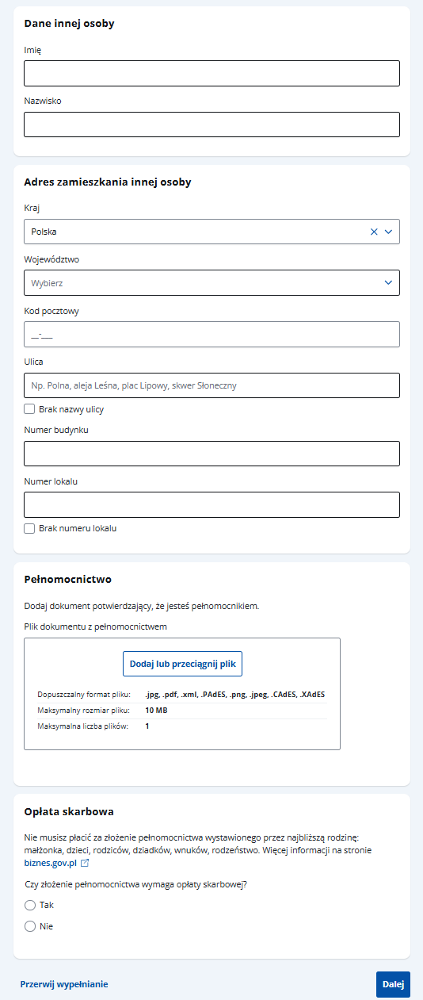  **Opłata skarbowa:**  Sekcja Opłata Skarbowa na pierwszej stronie formularza:   1. Jeżeli w sekcji Opłata skarbowa zostanie zaznaczony radiobutton:   „Czy złożenie pełnomocnictwa wymaga opłaty skarbowej” -> NIE, to sekcja w formularzu nie zawiera dodatkowych pól:  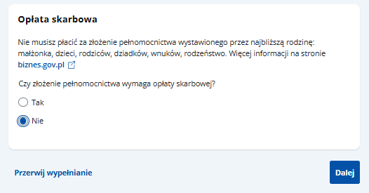  b) Jeżeli w sekcji Opłata skarbowa zostanie zaznaczony radiobutton:  „Czy złożenie pełnomocnictwa wymaga opłaty skarbowej” -> TAK, to zostaje wyświetlone pole dodawania plików „Plik z potwierdzeniem przelewu”  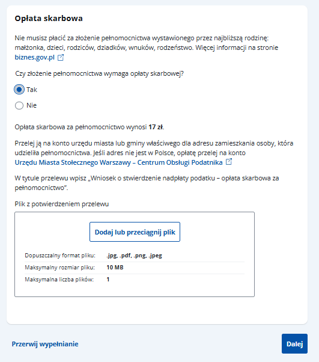 |  |
| 3 | Wniosek o stwierdzenie nadpłaty podatku -  zaznaczona opcja w sekcji Podmiot wniosku = „Osoby prawnej lub jednostki organizacyjnej” | 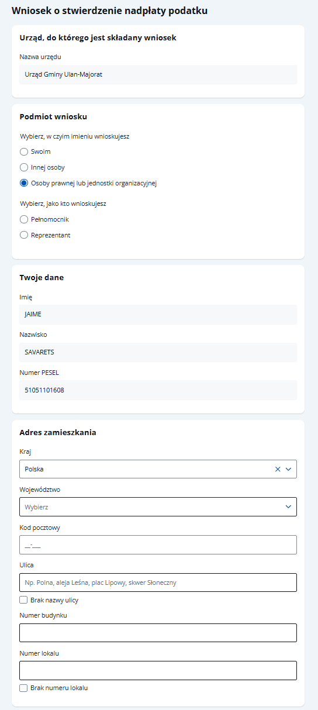  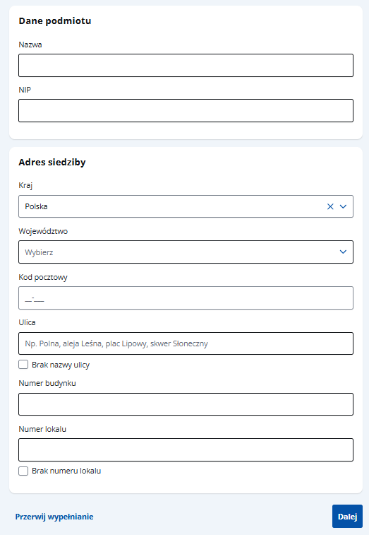 | Jeżeli w polu radio „Wybierz, jako kto wnioskujesz” zostanie zaznaczony:   1. Pełnomocnik – pod sekcją Adres siedziby, zostają wyświetlone sekcje:   - Pełnomocnictwo  - Opłata skarbowa za pełnomocnictwo  (screeny w wierszu 4)   1. Reprezentant - pod sekcją Adres siedziby, zostaje wyświetlona sekcja:   - Potwierdzenie, że jesteś reprezentantem  (screeny w wierszu 5) |
| 4 | W polu radio „Wybierz, jako kto wnioskujesz” zaznaczony:   1. Pełnomocnik – pod sekcją Adres siedziby, zostają wyświetlone sekcje:   - Pełnomocnictwo  - Opłata skarbowa za pełnomocnictwo | 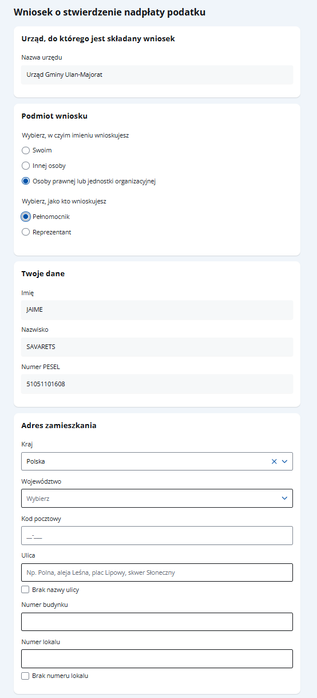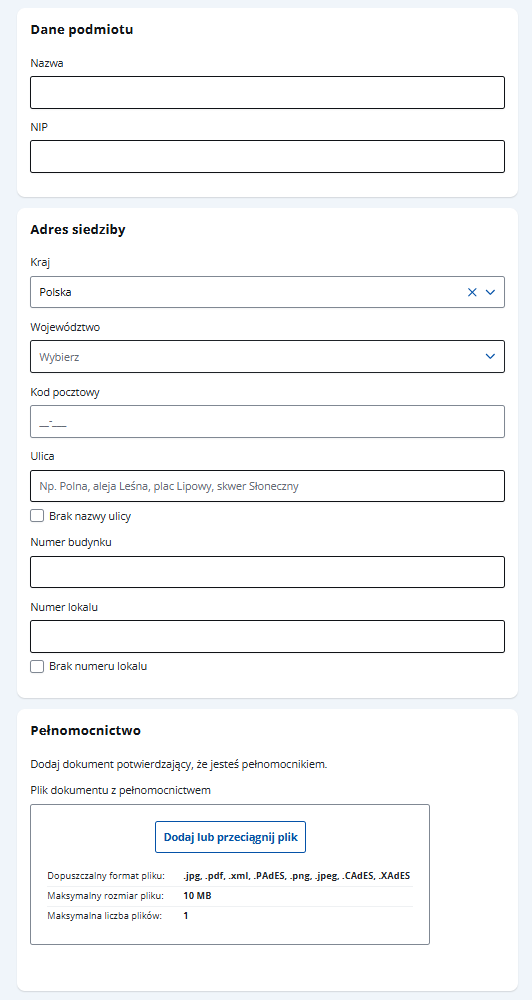  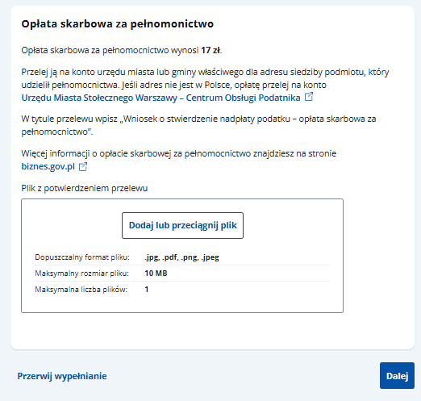 |  |
| 5 | Jeżeli w polu radio „Wybierz, jako kto wnioskujesz” zostanie zaznaczony:   1. Reprezentant - pod sekcją Adres siedziby, zostaje wyświetlona sekcja:   - Potwierdzenie, że jesteś reprezentantem  (screeny w wierszu 5) | 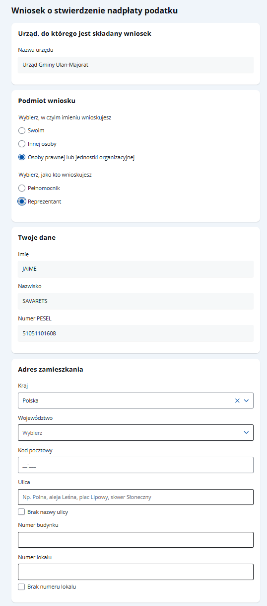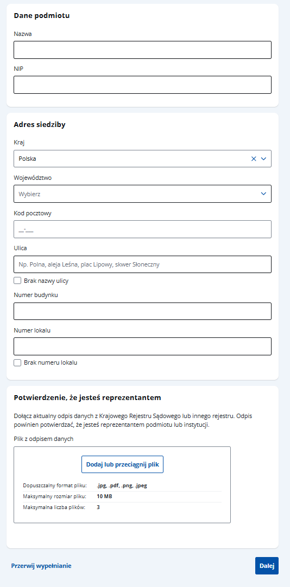 |  |
| 6 | Strona 2- tematyczna dot. Nadpłaty i deklaracji podatkowej.  Użytkownik na 1 stronie wybrał w polu **Podmiot wniosku/**  Wybierz, w czyim imieniu wnioskujesz ->  Swoim, uzupełnił wymagane pola i przeszedł do drugiej strony formularza. | 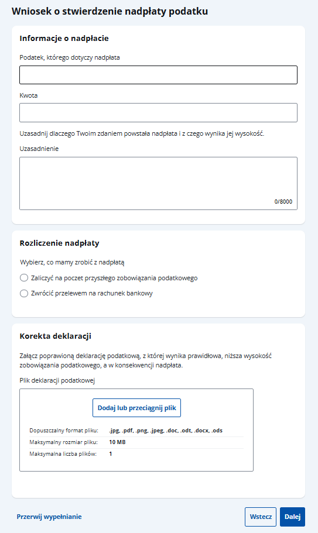  Jeżeli w polu „Rozliczenie nadpłaty” zostanie zaznaczona opcja „Zaliczyć na poczet przyszłego zobowiązania podatkowego”, to zaprezentowane zostaje pole Nazwa podatku:  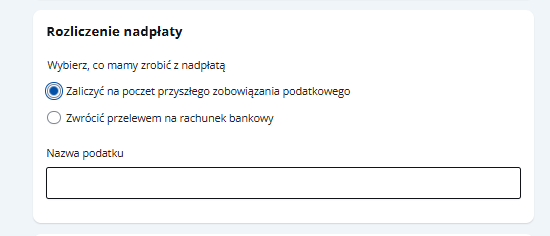  Jeżeli w polu „Rozliczenie nadpłaty” zostanie zaznaczona opcja „Zwrócić przelewem na rachunek bankowy”, to zaprezentowane zostaje pole Numer rachunku:  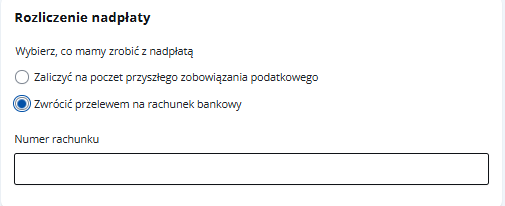 | Pola „Nazwa podatku” i „Numer rachunku” są wyświetlane na drugiej stronie zależnie od wyboru użytkownika w sekcji „Rozliczenie nadpłaty”, w polu „Wybierz, co mamy zrobić z nadpłatą”.  Wyświetlanie tych pól jest sterowane warunkiem jsonaty |
| 7 | 3 strona tematyczna Wniosku o stwierdzenie nadpłaty podatku – Dane do kontaktu i zgoda na przetwarzanie danych osobowych. | 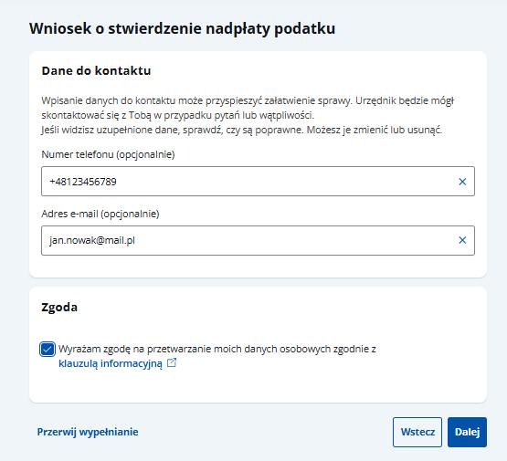 |  |