**Wniosek o ustalenie numeru porządkowego nieruchomości – wizualizacja formularza po cyfryzacji**

|  |  |  |  |
| --- | --- | --- | --- |
| **Lp.** | **Strona** | **Formularz** | **Stany dynamiczne** |
| 1 | Wniosek o ustalenie numeru porządkowego nieruchomości – zaznaczona opcja w sekcji Podmiot wniosku = „Swoim” | **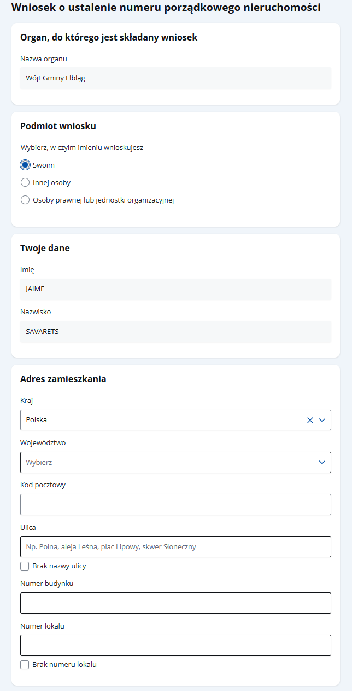** | Jeżeli w polu Podmiot wniosku zostanie wybrana opcja:  **a) „Innej osoby”** to pod adresem zamieszkania prezentowane są dodatkowe sekcje:  - Dane innej osoby,  - Adres zamieszkania innej osoby,  - Pełnomocnictwo,  - Opłata skarbowa.  (screeny w wierszu 2)  **b) „Osoby prawnej lub jednostki organizacyjnej”,** to:  w sekcji **Podmiot wniosku** prezentowane jest pole typu radiobutton **„Wybierz, jako kto wnioskujesz”,** a  pod sekcją Adres zamieszkania prezentowane są dodatkowe sekcje:  - Dane podmiotu  - Adres siedziby  (screeny w wierszu nr 3) |
| 2. | Wniosek o ustalenie numeru porządkowego nieruchomości – zaznaczona opcja w sekcji Podmiot wniosku = „Innej osoby” | **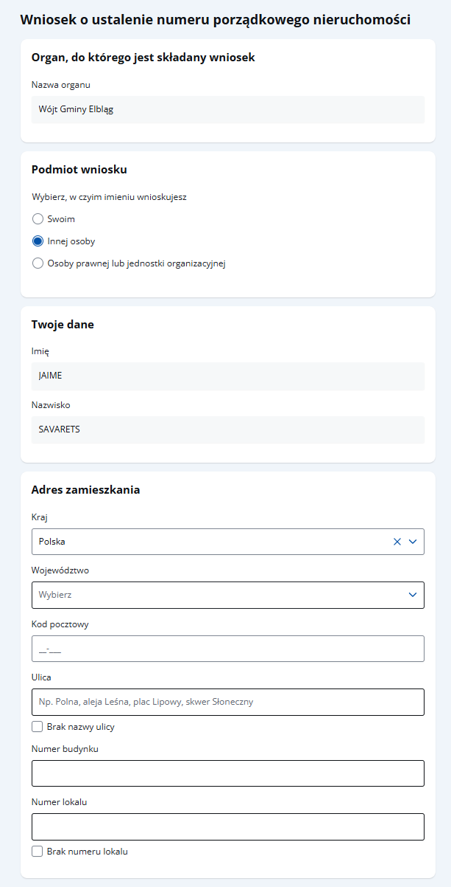**  **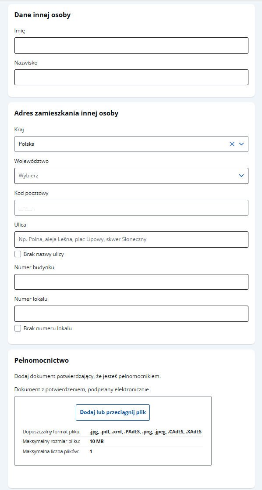**  ****  Jeżeli w sekcji Opłata skarbowa, w polu „Czy złożenie pełnomocnictwa wymaga opłaty skarbowej?”, zostanie zaznaczona wartość NIE, to nie jest wyświetlane dodatkowe pole i można przejść do drugiej strony formularza.    Jeżeli w sekcji Opłata skarbowa, w polu „Czy złożenie pełnomocnictwa wymaga opłaty skarbowej?”, zostanie zaznaczona wartość TAK, to w sekcji Opłata skarbowa zostaje wyświetlone dodatkowe pole dodawania plików:  **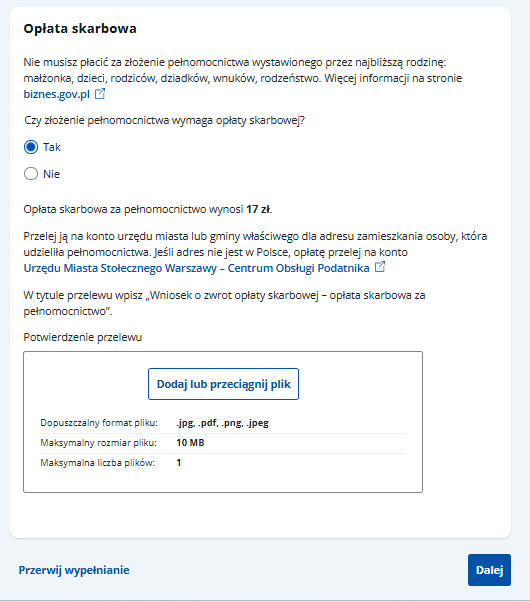** |  |
| 3 | Wniosek o ustalenie numeru porządkowego nieruchomości – zaznaczona opcja w sekcji Podmiot wniosku = „Osoby prawnej lub jednostki organizacyjnej” | 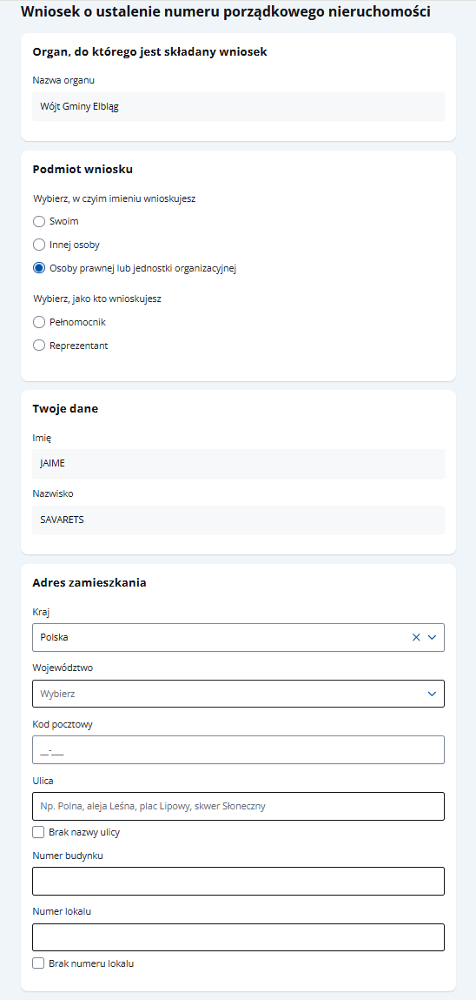  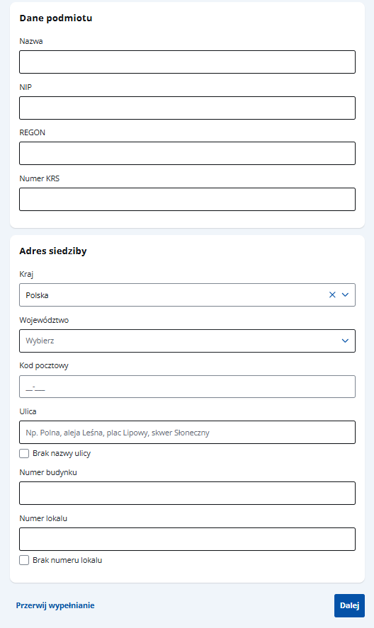 | Jeżeli w polu radio „Wybierz, jako kto wnioskujesz” zostanie zaznaczony:   1. Pełnomocnik – pod sekcją Adres siedziby, zostają wyświetlone sekcje:   - Pełnomocnictwo  - Opłata skarbowa za pełnomocnictwo  (screeny w wierszu 4)   1. Reprezentant - pod sekcją Adres siedziby, zostaje wyświetlona sekcja:   - Potwierdzenie, że jesteś reprezentantem  (screeny w wierszu 5) |
| 4 | W polu radio „Wybierz, jako kto wnioskujesz” zostanie zaznaczony:   1. Pełnomocnik – pod sekcją Adres siedziby, zostają wyświetlone sekcje:   - Pełnomocnictwo  - Opłata skarbowa za pełnomocnictwo | 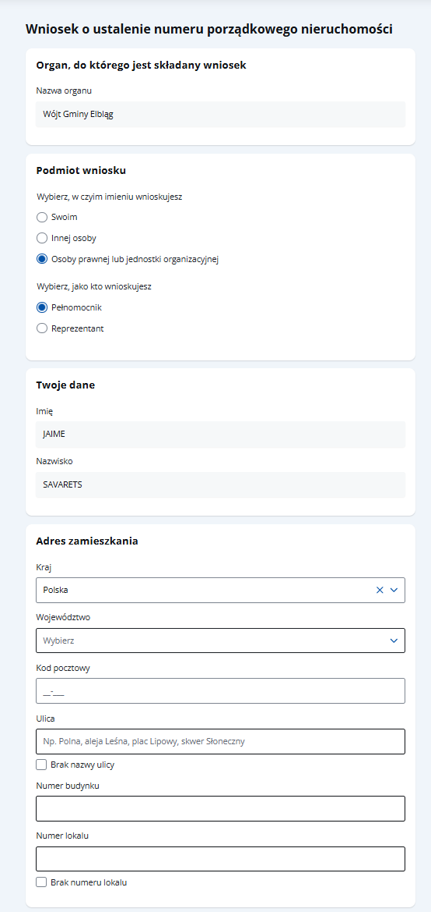 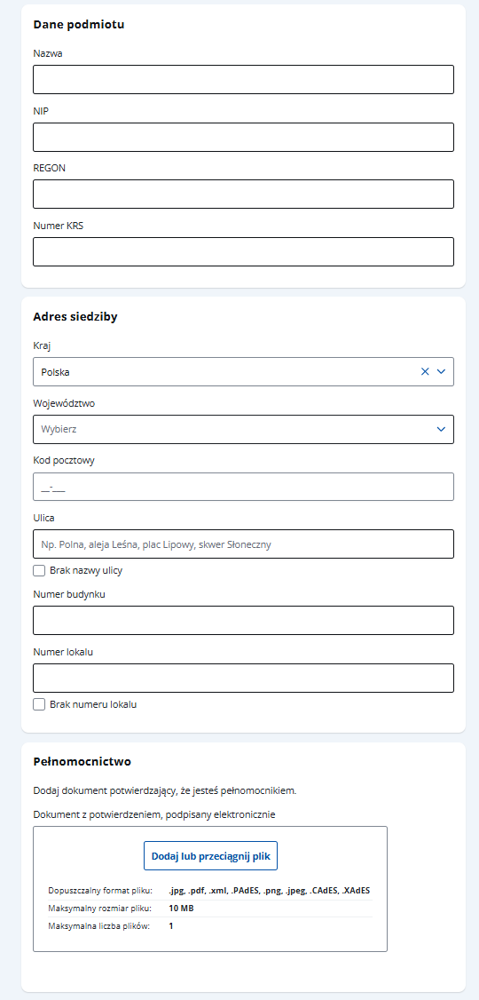 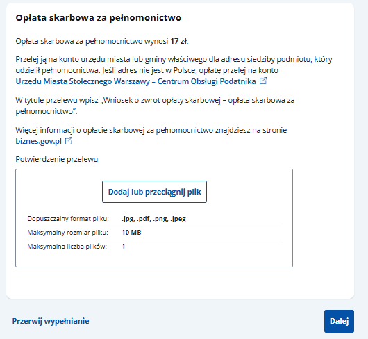 |  |
| 5. | Jeżeli w polu radio „Wybierz, jako kto wnioskujesz” zostanie zaznaczony:   1. Reprezentant - pod sekcją Adres siedziby, zostaje wyświetlona sekcja:   - Potwierdzenie, że jesteś reprezentantem  (screeny w wierszu 5) |   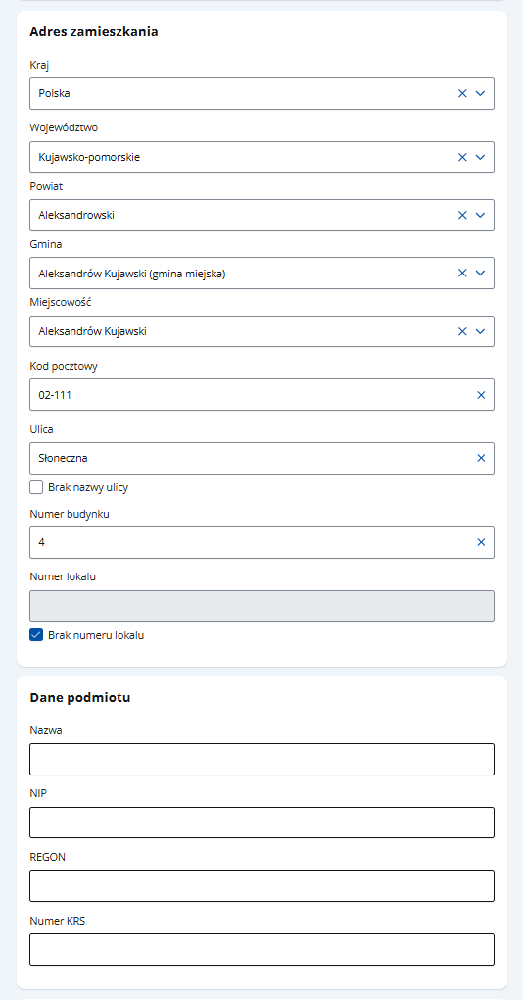  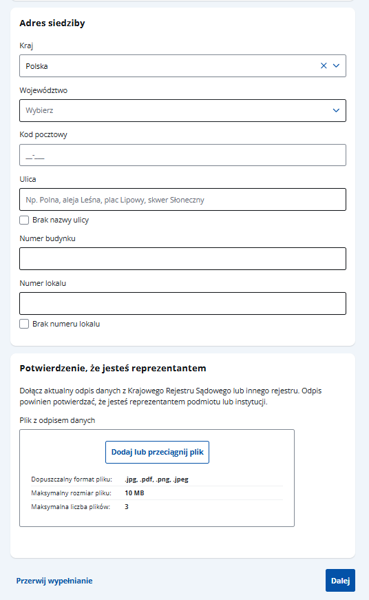 |  |
| 6. | Wniosek o ustalenie numeru porządkowego nieruchomości – tematyczna strona 2 formularza – Lokalizacja budynku | 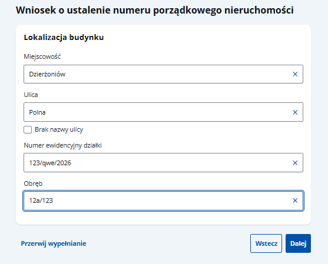 |  |
| 7. | Wniosek o ustalenie numeru porządkowego nieruchomości – tematyczna strona 3 formularza – Dane do kontaktu |  |  |